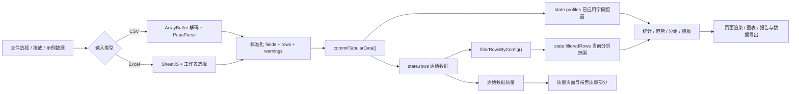

# Smart Tabular Analyzer v2.6.1 架构说明

本文描述当前发布版本的实际实现，而不是未来目标架构。它面向维护者，用于理解状态、导入、分析、渲染和导出之间的关系。

## 架构概览

Smart Tabular Analyzer 是一个无后端、无数据库、无构建步骤的静态浏览器应用：

- `index.html` 定义页面结构，并从仓库内的 `vendor/` 目录加载 PapaParse、Chart.js 和 SheetJS。
- `style.css` 提供桌面端与移动端样式。
- 浏览器端逻辑按职责分在 10 个普通 `<script>` 文件里（经典脚本，共享同一个全局作用域，没有打包器或模块系统），加载顺序和职责见下方“应用脚本”表。
- 启动自检：`script.js` 一开始就调用 `ensureDomElementsPresent()`。它先用 `typeof` 检查前 9 个应用脚本各一个代表函数（如 `toNumber`、`commitTabularData`），缺失说明缓存里的旧 `index.html` 只加载了 `script.js`，或某个文件没有加载成功；脚本齐全时再检查 `dom` 映射中的元素是否都存在，缺失说明缓存里的旧 `index.html` 缺少新元素。任一项缺失，就在页面顶部插入内联样式的“页面已更新，请刷新后再使用。”提示条和“刷新页面”按钮，并抛出列出缺失文件或键名的错误，阻止 `script.js` 后续代码执行，因此不会绑定任何业务事件；全部齐全时什么都不做。`index.html` 引用 `style.css?v=<版本>`，全部 10 个应用脚本也都带 `?v=<版本>`，发版时随版本号一起更新，以减少新旧文件混用。
- CSV、Excel、筛选、统计和报告生成均在浏览器本地完成。
- 当前导入上限由 `IMPORT_LIMITS` 统一控制：25 MB、100,000 行数据、200 列。

### 应用脚本

应用脚本按以下顺序加载，都在三个 `vendor/` 脚本之后；职责说明与各文件第一行的注释一致：

| 顺序 | 文件 | 职责 |
| --- | --- | --- |
| 1 | `parsing.js` | 单元格值的缺失判断与解析：疑似缺失值的写法清单，把原始文本安全地转换为数值（可按字段的数字策略读取单位、万/亿和全角数字）和日历日期（按书写的日历日，不受时区影响）。 |
| 2 | `profiling.js` | 字段识别：根据取值判断字段类型（ID / 日期 / 数值 / 分类），生成字段 profile，并提供按字段读取 profile 的工具。 |
| 3 | `format.js` | 显示格式化：数值、整数、百分比和字段格式的展示文本，带单位的字段标签，表头位置说明，ID 重复值的行号列表和说明文字，疑似缺失值、按单位读取的数字和疑似数值列的说明文字，CSV 解析警告的中文消息，问题行的按钮、类别和摘要文字，以及 HTML 转义。 |
| 4 | `stats.js` | 统计计算：描述统计、IQR 异常值、分类频数、分组聚合、日期趋势和直方图分箱。 |
| 5 | `quality.js` | 数据质量：类型转换失败计数与样例、精确重复行判断与去重、ID 字段重复值、疑似缺失值、按单位读取的数字、疑似数值列、缺失率等级、质量页使用的原始数据数值统计，以及每类质量计数背后的问题行列表。 |
| 6 | `app.js` | 应用状态与界面：state 和 dom 映射、导入 / 筛选 / 字段配置三条刷新路径，以及概览（含分页的数据预览）、字段、质量（含问题行查看区）、统计、图表和自定义分析的渲染。 |
| 7 | `importer.js` | 文件导入：CSV / Excel 的读取、编码识别、解析、表头保护、导入上限校验和导入并发保护，最后交给 commitTabularData() 提交。 |
| 8 | `templates.js` | 场景模板：模板定义、字段映射表单、各模板的分析计算和结果渲染。 |
| 9 | `report.js` | 报告与导出：报告快照、HTML / Markdown 报告生成、处理后 CSV 导出和问题行 CSV 导出、导出门禁、文件名和下载。 |
| 10 | `script.js` | 启动入口（最后加载）：启动自检、Chart.js 全局样式、页面导航和全部事件绑定。所有加载时立即执行的代码都只放在这里。 |

- 所有加载时立即执行的代码（启动自检、Chart.js 全局样式、导航设置和全部事件绑定）只放在最后的 `script.js`。前 9 个文件只声明函数和常量，加载时唯一的 DOM 操作是 `app.js` 构造 `dom` 映射时调用 `getElementById()`。
- `parsing.js`、`profiling.js`、`format.js`、`stats.js`、`quality.js` 是纯逻辑层，不直接访问 DOM 或第三方全局对象；但其中部分函数会在调用时读取 `state`（例如经由 `getFieldProfile()`）和 `getAnalysisRows()`（两者都定义在 `app.js`），所以还不是纯函数。
- 经典脚本共享全局作用域：重复的顶层 `const` / `let` 会让后加载的整个文件无法执行，重复的函数声明会静默覆盖前一个。`tests/core.test.cjs` 会检查全部应用脚本的顶层名字不重复。

| 外部依赖 | 当前职责 | 代码访问方式 |
| --- | --- | --- |
| PapaParse | CSV 解析和 CSV 导出序列化 | `window.Papa` / `Papa` |
| SheetJS | `.xlsx` / `.xls` 工作簿解析 | `window.XLSX` / `XLSX` |
| Chart.js | 页面图表和报告图表快照 | `window.Chart` / `Chart` |

## 文件结构

```text
.
├── index.html                  # 页面结构、控件和 vendor/ 依赖引用
├── style.css                   # 页面样式与响应式规则
├── parsing.js                  # 缺失判断与疑似缺失值清单，数值和日期解析
├── profiling.js                # 字段类型识别和字段 profile
├── format.js                   # 显示格式化、表头位置 / ID 重复值 / 疑似缺失值 / 解析警告 / 问题行文字、HTML 转义
├── stats.js                    # 描述统计、IQR、分组、趋势、直方图
├── quality.js                  # 转换失败、重复行、ID 重复值、疑似缺失值、缺失率等级、问题行列表
├── app.js                      # state / dom、三条刷新路径、页面渲染（含预览分页和问题行查看区）
├── importer.js                 # CSV / Excel 导入和导入并发保护
├── templates.js                # 场景模板
├── report.js                   # 报告生成、数据导出和问题行导出
├── script.js                   # 启动入口（最后加载）：自检、导航和事件绑定
├── package.json                # Node 测试命令
├── .nojekyll                   # 空文件，让 GitHub Pages 跳过 Jekyll、原样发布 vendor/
├── .gitattributes              # vendor/** 与 tests/fixtures/stage3/** -text，禁止换行转换，保证 integrity 和夹具字节不变
├── vendor/                     # 自行托管的 PapaParse、Chart.js、SheetJS（文件名带版本号）
│   └── licenses/               # 三个库的原始许可证文件
├── examples/
│   └── sample-*.csv            # 内置与手工测试用虚构数据
├── assets/                     # README 截图
├── tests/
│   ├── test-context.cjs        # VM + 轻量假 DOM 测试环境
│   ├── data-processing.test.cjs
│   ├── basic-data-processing.test.cjs
│   ├── destructive-qa.test.cjs
│   ├── core.test.cjs
│   └── fixtures/               # 测试夹具；stage3/ 是表头检测的验收夹具
├── docs/                       # 开发者维护文档
└── .github/workflows/ci.yml    # push / PR 自动回归测试
```

## 核心数据流



当前实现依赖以下不变量：

1. `state.rows` 是导入后原始数据的事实来源；筛选和去重不得改写它。
2. 普通分析统一通过 `getAnalysisRows()` 读取当前范围。
3. 质量页始终基于原始 `state.rows`；筛选不会改变缺失、重复、ID 重复值、疑似缺失值和异常值口径。
4. 字段类型修正只更新 profile，不改写原始单元格；转换发生在统计时。
5. 每次新导入必须通过 `beginImport()` 生成新的导入 ID，旧异步结果不得提交。
6. Chart.js 实例创建前必须销毁旧实例，全部实例统一登记在 `state.charts`。
7. 报告只有在分析完成且没有未应用字段类型草稿时才能导出。

## 1. Application State（应用状态）

**主要职责**

- 保存当前唯一数据集、字段顺序、字段画像、筛选结果、统计缓存、图表实例和来源元信息。
- 隔离连续导入产生的异步回调。
- 维护“原始数据质量”与“当前筛选分析”两个不同的数据范围。
- 为所有 renderer、图表和导出流程提供共享状态。

`state` 是当前唯一的应用级可变状态，主要字段按职责分组如下：

| 状态分组 | 字段 | 含义 |
| --- | --- | --- |
| 原始数据 | `rows`, `fields` | 完整原始记录和固定字段顺序 |
| 当前分析范围 | `filteredRows`, `filterSourceRows`, `filters` | 当前筛选结果、来源身份保护和已应用条件 |
| 字段配置 | `profiles`, `fieldTypeDrafts`, `manualFieldTypes` | 自动识别结果、已应用类型、未应用草稿，以及用户应用的、和自动识别不同的类型（见“疑似缺失值”的手动类型记录） |
| 疑似缺失值 | `placeholderConfirmations`, `placeholders` | 字段 → 已确认按缺失处理的写法；`buildPlaceholderSummary()` 的结果。每次提交整体替换为空，`resetAnalysisState()` 清空，筛选不改它们（见“疑似缺失值”） |
| 疑似数值列 | `numericLooking` | `buildNumericLookingSummary(state.profiles)` 的结果。`commitTabularData()` 和 `rebuildAnalysisFromProfiles()` 整体替换，`resetAnalysisState()` 清成 `[]`，筛选不改它（见“数字策略”） |
| 派生分析 | `numericStats`, `qualityNumericStats`, `categoryStats`, `insights`, `customAnalysis` | 当前统计、原始质量统计、结论和自定义分析快照。没有筛选掉任何行时，`numericStats` 与 `qualityNumericStats` 是**同一个数组**（见“Statistics”），禁止原地修改其中的数组或对象 |
| 质量信息 | `duplicateRows`, `idDuplicates`, `totalMissing`, `parseWarnings` | 原始数据重复、ID 字段重复值（`buildIdDuplicateSummary()` 的结果，见“ID 字段重复值”）、缺失和 CSV 解析警告（全部保存，每条 `{ row, code, message }`，`row` 是精确的文件行号或 `null`，见“数据行的文件行号”） |
| 数据预览 | `previewPage` | 预览的页码（从 1 开始），`renderPreview()` 把它夹到有效范围；导入、筛选变化和字段配置（含疑似缺失值确认）回到 1，`resetAnalysisState()` 也设为 1（见“问题行”） |
| 问题行 | `problemCategories`, `problemView`, `problemViewOpener` | `renderQuality()` 时的 `listProblemCategories()`（“查看”按钮带它的下标）；打开的查看区 `{ category: { kind, field, key }, page, list }` 或 `null`；打开查看区的那个“查看”按钮，关闭时把焦点还给它。导入时关闭，`resetAnalysisState()` 清空，筛选不改（见“问题行”） |
| 文件行号 | `sourceRowNumbers` | `WeakMap<行对象, 文件行号>`。只由 `commitTabularData()` 写入（每次提交整体替换），`resetAnalysisState()` 换成空的 WeakMap；通过 `getSourceRowNumber(row)` 读取，查不到返回 `null`。行对象本身不加字段，筛选和去重结果与 `rows` 共享行对象，所以同样能查到 |
| 表头检测 | `headerDetection` | `null`，或 `{ headerRowNumber, skippedRows: [{ rowNumber, preview }] }`：导入时跳过了表头上方的标题行才有值。只由 `commitTabularData()` 写入（每次提交整体替换），`resetAnalysisState()` 清空；筛选和字段配置两条刷新路径不改它 |
| 导入控制 | `pendingExcel`, `activeFileReader`, `activeImportId` | 多工作表等待状态、当前读取器和导入版本号 |
| 来源与完成状态 | `sourceFileName`, `sourceSheetName`, `sourceType`, `analysisCompletedAt` | 报告元信息和导出门禁 |
| 图表与筛选 UI | `charts`, `categoryFilterOptions`, `categoryFilterDraftValues` | Chart 实例及分类筛选草稿 |

**主要函数**

- `beginImport()`：递增 `activeImportId`、取消旧读取、清空旧分析并锁定导入控件。
- `isCurrentImport(importId)`：判断异步结果是否仍属于当前导入。
- `abortActiveFileRead()`：中止仍在运行的 `FileReader`。
- `commitTabularData(...)`：成功导入的统一提交点；写入状态、生成派生数据并触发首轮渲染。第 9 个参数 `rowNumbers`（默认 `null`）与 `rows` 一一对应，长度一致时才写入 `sourceRowNumbers`。
- `getSourceRowNumber(row)`：返回行对象的文件行号；没经过 `commitTabularData()`（例如测试直接给 `state.rows` 赋值）或导入没给行号时返回 `null`。
- `getAnalysisRows()`：只有 `filterSourceRows === state.rows` 时才返回 `filteredRows`，否则回退到原始行。
- `refreshFilteredAnalysis()`：筛选后重算当前范围的统计、结论、图表和导出状态。
- `rebuildAnalysisFromProfiles(message, setMessage)`：字段类型提交或疑似缺失值确认后清除筛选，并重建依赖字段类型的全部结果；`setMessage` 决定结果消息写到哪里，默认是字段配置区。
- `updatePlaceholderConfirmations()`：第 4 条刷新路径，疑似缺失值的确认、撤销和全部确认都经过它（见“疑似缺失值”）。
- `resetAnalysisState()`：销毁图表，同时清空领域状态和结果 DOM；不会把 `activeImportId` 重置为旧值。

**输入 / 输出**

- 输入：规范化后的 `{ fields, rows }`、导入元信息、用户筛选和字段配置操作。
- 输出：更新后的全局 `state`。大多数状态函数没有返回业务对象，而是通过状态和 DOM 副作用完成工作。
- `filteredRows = rows.slice()` 只复制数组；行对象仍与 `rows` 共享，因此下游必须保持只读。

**与其他模块的关系**

- 所有模块都直接或间接读取 `state`（定义在 `app.js`），它是当前代码中耦合度最高的中心。
- File Input & Parsing 最终调用 `commitTabularData()`。
- Profiling、Statistics 和 Filtering 生成派生状态。
- Visualization、UI Rendering 和 Export 消费这些状态。

## 2. File Input & Parsing（文件输入与解析）

**主要职责**

- 接受文件选择、拖放和内置示例数据。
- 检查文件大小与扩展名，并路由到 CSV 或 Excel 流程。
- 管理完整文件读取和连续上传的并发隔离。
- 将不同输入统一为 `fields + rows`，再交给同一个提交入口。

**主要函数**

| 函数 | 职责 |
| --- | --- |
| `parseDataFile(file)` | 检查 25 MB 上限，按 `.csv`、`.xlsx`、`.xls` 后缀路由 |
| `parseCsvFile(file)` | 读取 CSV 编码选择、获取 `ArrayBuffer`、解码并进入 PapaParse |
| `parseCsvText(text, sourceName, importId, retry, wholeText)` | 以表头模式调用 PapaParse；`retry` 只在跳过标题行后的那一次重新解析时传入；`wholeText` 只在空记录占满行数预览后的那一次重新解析时传入，去掉 `preview` |
| `handleParsedData(results, sourceName, importId, source)` | 校验 PapaParse 结果，规范化字段和行；表头类错误时尝试跳过标题行重试一次 |
| `findCsvHeaderBelowTitleRows(text)` / `retryCsvBelowTitleRows(...)` | CSV 的表头行检测和切片重试，见下文“表头行检测” |
| `findCsvRecordLines(text, meta, dataRowCount)` | CSV 的第二遍扫描，求每条记录和每条数据记录的起始文件行号，见下文“数据行的文件行号” |
| `findCsvRecordLine(text, meta, index, dataRecords)` / `parseErrorLineNumber(error, lines, lineOffset)` | 只读到某一条记录为止求它的行号（报错用）；把 PapaParse 的错误 `row` 换算成文件行号（警告用） |
| `csvHasMoreDataRecordsThan(text, meta, limit)` | 只计数、不保存行的扫描，判断数据记录是否超过上限，见下文“数据行的文件行号” |
| `lineNumbersAtOffsets(text, offsets)` | 把文本偏移量换算成文件行号，表头检测和行号扫描共用 |
| `detectHeaderRow(rows, kind)` | CSV 与 Excel 共用的表头行检测纯函数 |
| `encodeCsvHeaderForParser()` / `decodeCsvHeaderFromParser()` | 用唯一内部键保护重复、空白及 `__proto__` 等特殊表头 |
| `normalizeFieldName()` / `normalizeParsedRow()` | 去除表头 BOM 和空格，并生成无原型行对象 |
| `readFileAsArrayBuffer(file, importId)` | 通过 `FileReader` 或 `file.arrayBuffer()` 读取完整文件 |
| `commitTabularData(...)` | 接收最终标准化数据并提交到应用状态 |

主解析的 PapaParse 配置为：

- `header: true`
- `skipEmptyLines: true`
- `preview: 100001`
- `worker: false`

导入成功、即将提交的 CSV 还会再调用一次 `Papa.parse` 求文件行号（`header: false`，见下文“数据行的文件行号”）；主解析的选项和回调不变。`preview` 计的是 PapaParse 读到的全部记录（含空记录），空行多的文件可能在上限之内就被截断，这时走下文的补救路径。

关闭 Worker 是有意行为：`transformHeader` 是函数，无法由 PapaParse Worker 克隆；保留主线程解析可以继续执行项目自己的特殊表头和重复表头检查。

`handleParsedData()` 的关键校验包括：

- 数据列多于表头时拒绝导入，避免额外单元格被静默丢弃。报错“CSV 第 N 行的数据列多于表头……”的 N 是精确的文件行号，只在真的要显示这条报错时才求（见下文“数据行的文件行号”）。
- 缺失引号（`MissingQuotes`）是致命错误，报错为“CSV 第 N 行开始的引号没有闭合，之后的内容无法正确分列。请检查该行的引号后重试。”，算不出行号时为“CSV 中有引号没有闭合，之后的内容无法正确分列。请检查文件里的引号后重试。”；有效的分隔符错误也是致命错误（PapaParse 5.4.1 的 Delimiter 类只有 `UndetectableDelimiter`，这条分支目前走不到）。
- `UndetectableDelimiter`（PapaParse 猜不出分隔符、按逗号拆分）：字段多于 1 列时去掉（逗号显然切对了）；只有 1 列、并且这一列的表头原文里有 `;`、制表符或 `|` 时，保存一条 `row: null` 的中文警告“整份文件只读出 1 列，但表头里有分号（；）。如果原文件是用分号分隔的，请另存为逗号分隔的 CSV 后重新上传。”（按实际字符写分号 / 制表符 / 竖线）；其余单列文件不提示。PapaParse 只在前 10 行（含表头）的平均列数不超过 1.99 时报这个错，所以两列文件前 10 行里有一行少列时就会出现。
- 表头去 BOM、去首尾空格后必须唯一。
- 空表头下存在数据时拒绝导入；完全空的尾列可忽略。
- 空数据行被过滤，它们的行号也一起去掉；最终必须至少有一个字段和一行数据。
- 非致命 PapaParse 问题全部保存到 `parseWarnings`，不设上限（10 万行全都少列时约 15 MB），每条 `{ row, code, message }`：`code` 保留 PapaParse 的 code，`message` 由 `formatCsvWarningMessage()` 按 code 生成中文（TooFewFields：“第 N 行只有 M 列（表头有 K 列），缺少的单元格按空值处理。”，M 从这一行解析出的对象自己数；InvalidQuotes：“第 N 行有不规范的引号（引号后面紧跟了其他字符），这一行可能被读错。”；没有行号时改用“有一条记录……”“有一处……”的说法）。状态栏写“发现 N 个解析警告，涉及 M 行”，M 是非空行号去重后的个数，两个数都经 `formatInteger()`；报告的 `parseWarningCount` 是真实总数，明细仍截 50 条。
- 前三类表头错误（数据列多于表头、空表头下有数据、重复表头）会先尝试表头行检测，见下文。

### 表头行检测（v2.2.0）

表头上方的标题行、说明行和空行由 `detectHeaderRow()` 自动跳过，CSV 和 Excel 共用同一套规则：

- **触发时机**：只有第一个非空行在现有表头校验中报错时才运行。Excel 是“缺少表头”“未识别到有效文本表头”“重复表头”；CSV 是 `TooManyFields`、“空表头下有数据”“重复表头”。第一个非空行能通过校验的文件完全走原来的路径：CSV 的主解析只调用一次 `Papa.parse`，不做表头检测的扫描（提交前另有一遍求行号的扫描，见下文“数据行的文件行号”）。
- **输入 / 输出**：二维数组（Excel 传 `sheet_to_json` 的原始值，CSV 传 PapaParse `header: false` 的字符串）和 `kind`；返回 `{ status: "unchanged" | "skipped" | "fallback", headerIndex, skippedIndexes, attempted }`。它是纯函数，不碰 DOM 和 `state`。
- **扫描范围**：从第一个非空行起，最多 `HEADER_SCAN_ROWS`（10）行。
- **可跳过的行**：空行（含 CSV 里只有分隔符的行）；只有 1 个非空格且是文本；只有 2 个非空格、都是文本、且至少一格含 `:` 或 `：`。“文本”指值是字符串，并且 `toNumber()` 和 `toDate()` 都解析不出来；Excel 的数字和日期单元格不算文本。第一个非空行本身不可跳过时直接回退，`attempted` 为 `false`。
- **候选表头**：第一个非空行之后第一个不可跳过的行，必须同时满足：通过与导入相同的表头校验（`findHeaderRowError()` 复用 `checkExcelHeaderFields()`、`findDuplicateCsvHeaders()`、`csvBlankHeaderHasData()`；CSV 另外要求下方各行的列数不超过表头，对应 PapaParse 的 `TooManyFields`）；下方数据行非空格数的众数不小于 2（并列时取较小值）；不被 `vetoesHeaderCandidate()` 的三条护栏否决——候选格能解析成数字而下方同列至少 80% 是数字、同样的日期规则、候选格去掉首尾空格后的值在下方同列出现过。
- **检测与完整校验分开**：只把前 `HEADER_SCAN_ROWS + HEADER_DETECTION_DATA_ROWS`（10 + 200）行交给检测；选中后仍对全部行走现有的完整校验和构建，失败就显示原来那条报错。
- **CSV 重试**：`retryCsvBelowTitleRows()` 调用 `findCsvHeaderBelowTitleRows()`，后者用 `header: false`、`preview: 210` 和 `step` 回调里的 `meta.cursor` 找到表头行的起始字符位置；然后从这里切开文本，用同一个 `importId` 再调用一次 `parseCsvText()`。`retry` 参数保证只重试一次，不会递归，也不调用 `beginImport()`；分隔符由第二次解析重新自动识别。重试中的失败显示第一次的报错（`retry.firstError()`，只在要显示时才生成，所以它里面的行号扫描不会让成功的重试多调用 `Papa.parse`），唯一的例外是重试里的 `TooManyFields`：表头已经通过了检测的校验，问题在某个数据行，所以显示重试自己的报错，即 `formatHeaderDetectionNote()` 的表头说明加“CSV 第 M 行的数据列多于表头……”，M 是重试文本里的行号加 `lineOffset`。
- **行号**：一律用文件行号。Excel 是 `!ref` 起始行加 `sheet_to_json` 的原始下标（`buildExcelTabularData()` 去掉的开头空行也计算在内）；CSV 是解码后文本（不含 BOM）里表头行之前的物理换行数加 1，由 `lineNumbersAtOffsets()` 计算。数据行、解析警告和“CSV 第 N 行”报错的行号都是精确的，见下文“数据行的文件行号”。
- **结果**：导入层返回 `headerDetection = { headerRowNumber, skippedRows: [{ rowNumber, cells }] }`，`skippedRows` 只含非空行；`commitTabularData()` 用 `formatSkippedRowPreview()` 把 `cells` 转成 `preview`（非空格用空格连接，超过 20 个字符截断加“…”）后写入 `state.headerDetection`。跳过的行数 K 一律等于 `headerRowNumber − 1`，空行也计算在内。状态栏在成功和“有解析警告”两种文案后面追加 `formatHeaderDetectionNote()` 生成的“表头在第 N 行，已跳过上方 K 行：「…」「…」。”，最多列 2 行摘要，更多时加“等”。
- **回退提示**：第一个非空行是可跳过的行（`attempted` 为 `true`）但没能确认表头时，在原报错后面追加 `formatTitleRowFallbackHint()` 的“第 N 行看起来像标题。如果表头不在第 N 行，请删除表头上方的标题行后重新上传。”，N 是第一个非空行的文件行号。多工作表时，这条报错显示在工作表选择面板里。
- **已知残留**：两列文件的表头只写了第一列、第二列是互不相同的文本时，会把第一条数据当成表头（状态栏会写明跳过了哪一行）；手动指定表头行计划在后续版本提供。多行表头、“合计”行、一个工作表里的多块表格都不在处理范围内。表头检测用不带策略的 `toNumber()`，把“5kg”当文本，分析却按字段的数字策略把它当数（见“数字策略”）：标题行下面直接是“苹果,5kg”这类没有表头的数据时，这一行会被当成表头，字段“5kg”下面的值按 kg 读成数值。

### 数据行的文件行号（v2.3.0）

每一条数据行都记下它在文件里的行号，供质量页和报告的“文件行号”使用：

- **含义**：Excel 是工作表行号（`!ref` 起始行加 `sheet_to_json` 的原始下标），即在 Excel 左侧看到的行号；CSV 是这条记录开始的物理行（CR、LF、CRLF 各算一次换行），跨行的引号单元格按第一行算，与记事本显示的行号一致。用 Excel / WPS 打开含跨行单元格的 CSV 时，后面记录看到的行号会比这里小（Excel 按记录计行）。
- **Excel**：`buildExcelTabularData()` 在过滤空行的 `.filter()` 之后、`.map()` 生成行对象的同时，产出 `rowNumbers = firstRowNumber + pair.index`；中间的空行被过滤后，它的行号也不会出现。
- **CSV**：主解析的选项和回调不变。`handleParsedData()` 通过全部校验、确认有数据可提交之后，调用 `findCsvRecordLines()` 对同一份文本再做一次 `Papa.parse`：`header: false`、`skipEmptyLines: false`、`worker: false`，`delimiter` 和 `newline` 取主解析的 `meta.delimiter` / `meta.linebreak`，用同步的 `step`。每条记录的起点是上一条记录 step 的 `meta.cursor`（第一条从 0 开始）。结果有两套：`records[i]` 是读到的每一条记录（含表头和空记录）的起始行；`data[i]` 先去掉 PapaParse 在 `skipEmptyLines: true` 下会跳过的记录（只有一个空字符串的记录，`isBlankCsvRecord()`，与 PapaParse 源码中的规则相同），再把剩下的第一条当作表头去掉，这与 PapaParse 先过滤空记录再取表头的顺序一致。`data` 与主解析的数据行一一对应，空数据行被过滤时行号一起去掉。
- **对不上就不给**：第二遍的数据记录数和主解析的数据行数不一致时，整份文件都不给行号（全部为 `null`），警告的行号也全部为 `null`，不做部分对齐，也不退回估算。
- **警告的行号**：`parseErrorLineNumber()` 按 PapaParse 错误的类别换算，两种 `row` 的含义不同（PapaParse 5.4.1 源码）：
  - FieldMismatch（`TooFewFields` / `TooManyFields`）的 `row` 是 `results.data` 的下标（跳过空记录、不含表头；应用传入字符串且不设 `chunkSize`，整份文本一次读完，下标不跨块累加），用 `data[row]`；
  - Quotes（`InvalidQuotes` / `MissingQuotes`）在解析器内部报出，`row` 是已读到的全部记录数（含表头和空记录），用 `records[row]`。
  只有空白、被 `handleParsedData()` 丢掉的行仍在 `results.data` 里，它的警告照样有行号，只是 `state.rows` 里没有这一行。
- **报错的行号（惰性求值）**：“数据列多于表头”和“引号没有闭合”只在真的显示报错时才由 `findCsvRecordLine()` 求行号：同样的 `header: false` 扫描，读到出错的那条记录就在 `step` 里 `parser.abort()`，只对这一个起点调用 `lineNumbersAtOffsets()`。报错消息是函数，交给 `retryCsvBelowTitleRows()` 后，只有不重试或重试失败、要显示第一次的报错时才调用，所以成功跳过标题行的文件（如 `成绩表-标题无逗号.csv`，第一次解析就报 TooManyFields）调用次数不变。第一行是表头、多一列的文件共调用 3 次（主解析、表头检测扫描、行号），引号没有闭合的共 2 次；没有原文时不扫描，报错不写“第 N 行”。25 MB 的文件多一列在最后一行时，报错多花约 0.25 s（Node 内测量）。
- **空记录占满行数预览**：主解析的 `preview: 100001` 计入空记录，空行多的文件会在数据不到上限时就被截断（`meta.truncated` 为真，过滤后的数据行数 ≤ 上限）。这时先用 `csvHasMoreDataRecordsThan()` 做一遍只计数、不保存行和偏移的 `header: false` 扫描，数到第 `maxRows + 2` 条非空记录（表头加 `maxRows + 1` 行数据）就 `abort()`：数到了按原来的超限报错；数不到就带 `wholeText` 用同样的选项、去掉 `preview` 再做一次主解析，结果照常走 `handleParsedData()`，`wholeText` 防止再次进入补救路径。内存上界是一遍不保存行的扫描加一次不超过 `maxRows` 数据行的完整解析。没有空行的超限文件不走这条路，仍只调用 1 次；正好 10 万行、结尾有几个空行的文件结果不变（10 万行），调用 4 次。重试路径（切开的文本）上同样适用。
- **重试路径**：跳过标题行后的重新解析，在切片文本上算出的行号再加上 `retry.lineOffset`。
- **不做扫描的情况**：超过行数上限、表头类错误、只有表头或空文件，都在第二遍扫描之前就报错；只有直接调用 `handleParsedData()`、没有原文时（测试中常见）也不扫描，警告的行号为 `null`。
- **计数**：`lineNumbersAtOffsets(text, offsets)` 按偏移量升序增量计数，整份文件只扫一遍，规则与原来逐个用 `/\r\n|\r|\n/` 计数相同（`"\r\n"` 算一次换行）；偏移量变小时从头重数。
- **存放**：导入器把 `rowNumbers` 传给 `commitTabularData()` 的第 9 个参数，提交时写进 `state.sourceRowNumbers`（WeakMap），由 `getSourceRowNumber(row)` 读取。
- **代价**：10 万行 CSV 的完整导入约多 50–100 ms（Node 内测量）。v2.6.0 的两套行号和全部警告不改变这个量级（10 万 × 5 列与 v2.5.0 相差约 0.1%）。

**输入 / 输出**

- 文件入口输入浏览器 `File`；示例入口输入 `fetch("examples/sample-data.csv")` 返回的文本。
- CSV 解析的标准输出是 `fields: string[]`、无原型 `rows: object[]` 和可选 `parseWarnings`。
- 成功路径没有直接返回值，而是调用 `commitTabularData()`；失败路径通过 `showError()` 清空结果并显示错误。

**与其他模块的关系**

- CSV 文件先经过 CSV Encoding，再进入 PapaParse。
- Excel 文件交给 Excel Workbook Handling。
- 两条路径最终都进入 Application State。
- UI Rendering 负责文件事件、加载状态和错误展示。

当前解析是完整读取、完整解码、完整解析，不是流式处理；接近导入上限时会占用主线程和浏览器内存。内置示例直接使用 `response.text()`，不经过用户选择的 CSV 编码。

## 3. CSV Encoding（CSV 编码）

**主要职责**

- 将 CSV `ArrayBuffer` 解码为 PapaParse 可消费的字符串。
- 支持自动识别、UTF-8、GBK 和 GB18030。
- 为状态提示返回实际采用的编码标签。

**主要函数**

- `decodeCsvBuffer(buffer, selectedEncoding)`：编码入口，返回 `{ text, label }`。
- `autoDecodeCsvBuffer(buffer)`：执行自动识别策略。
- `hasUtf8Bom(buffer)`：检查 `EF BB BF`。
- `decodeText(buffer, encoding, fatal)`：封装浏览器 `TextDecoder` 并生成可读错误。

自动识别并不是统计式编码检测，实际顺序是：

```text
UTF-8 BOM
→ 严格 UTF-8 解码
→ 失败后按 GB18030 解码
```

手动选择 UTF-8、GBK 或 GB18030 时，直接使用对应的 `TextDecoder` 编码名。

**输入 / 输出**

- 输入：CSV 文件的 `ArrayBuffer` 和 `auto | utf-8 | gbk | gb18030`。
- 输出：`{ text, label }`。
- 不支持的编码值或浏览器不支持的解码器会抛出错误。

**与其他模块的关系**

- `parseCsvFile()` 负责读取 `dom.fileEncoding.value` 并调用本模块。
- 解码成功后把 `text` 交给 `parseCsvText()`。
- 本模块只负责字节到文本，不判断分隔符、表头或字段类型。

自动模式对非 UTF-8 字节统一回退到 GB18030，因此 Big5、Shift-JIS 等其他编码可能被错误解释。手动非严格解码也可能产生替换字符，这是当前实现边界。

## 4. Excel Workbook Handling（Excel 工作簿处理）

**主要职责**

- 验证并读取 `.xlsx` / `.xls` 工作簿。
- 单工作表直接分析，多工作表暂停并等待用户选择。
- 校验工作表范围、表头和数据行。
- 把 Excel 单元格转换为统一的字符串行对象。

**主要函数**

| 函数 | 职责 |
| --- | --- |
| `parseExcelFile(file)` | 读取文件、校验签名，并通过 `readExcelWorkbook()` 调用 `XLSX.read(..., { type: "array", cellDates: true, cellNF: true })` |
| `validateExcelFileSignature(buffer, fileName)` | `.xlsx` 检查 ZIP `PK` 签名，`.xls` 检查 OLE 签名 |
| `showExcelSheetSelection(...)` | 把完整工作簿保存到 `state.pendingExcel` 并显示工作表下拉框 |
| `analyzeSelectedExcelSheet()` | 校验待选状态和当前选择 |
| `importExcelSheet(...)` | 校验 `!ref`，经 `readExcelSheetTable()` 读取所选工作表并提交 |
| `readExcelSheetTable(worksheet, sheetName)` | 粗检上限、`sheet_to_json` 并调用 `buildExcelTabularData()`，传入 `!ref` 起始行号用于换算文件行号 |
| `validateExcelWorksheetLimits()` | 根据工作表使用区域粗检行数和 200 列；行数额外留出 `HEADER_SCAN_ROWS` 行给表头上方的标题行 |
| `buildExcelTabularData()` | 去除首尾空行、经 `findExcelHeaderPosition()` 确定表头行、按表头以下的数据行检查 100,000 行上限、识别使用列、验证表头并生成 `{ fields, rows, rowNumbers }`，跳过标题行时另带 `headerDetection` |
| `normalizeExcelCellValue()` | Date 转 `YYYY-MM-DD`，其他原始标量转字符串 |

`readExcelSheetTable()` 当前使用：

```js
XLSX.utils.sheet_to_json(worksheet, {
  header: 1,
  defval: "",
  raw: true,
  blankrows: true
})
```

生产调用把同一份 `rawRows` 同时传给 `buildExcelTabularData(formattedRows, rawRows)` 的两个参数；当前没有另外读取一份格式化显示值。百分比格式会被识别（只看表头以下前 1,000 行，`EXCEL_FORMAT_SAMPLE_ROWS`；跳过标题行时取样起点跟着新表头走），货币等其他格式仍不读取。

**输入 / 输出**

- 输入：Excel `File`；多工作表时还包括用户选择的 `sheetName`。
- 中间输出：SheetJS workbook 或 `state.pendingExcel`。
- 最终输出：唯一、非空文本字段数组，以及由无原型对象组成的行数组。
- Date 对象被规范为 UTC 日期字符串；string、number、boolean 和 bigint 被转成字符串。

**与其他模块的关系**

- File Input & Parsing 负责路由和读取。
- UI Rendering 管理工作表选择面板及错误状态。
- 成功选择后调用 `commitTabularData(..., sheetName)`，后续 profiling、统计和渲染与 CSV 完全共用。

当前一次只分析一个工作表，不合并多表。表头默认是第一个非空行；它通不过表头校验时，按上文“表头行检测”在前 10 行内跳过标题行、说明行（含合并单元格的标题）和空行。最终选定的表头仍必须是唯一、非空的文本表头；多行表头、数值表头、识别不出的复杂标题区或异常 `!ref` 仍会被拒绝，此时如果第一个非空行像标题，报错后面会附加删除标题行的提示。整个工作簿保存在内存中，解析仍在主线程完成。

## 5. Field Profiling & Type Detection（字段画像与类型识别）

**主要职责**

- 基于原始行建立每列画像。
- 自动识别 `id`、`date`、`numeric` 或 `category`。
- 保存日期解析策略、数值格式和转换失败数量。
- 支持字段类型草稿、应用和恢复自动识别；`ignore` 只由用户选择。

**主要函数**

| 函数 | 职责 |
| --- | --- |
| `buildColumnProfile(field, rows, numberFormatHint, confirmedKeys)` | 生成完整 profile；第三个参数可选，是 Excel 导入时该列的格式提示（目前只有 `"percent"`），CSV 不传；第四个参数可选，是该字段已确认按缺失处理的疑似缺失值写法 |
| `inferFieldTypeKey(field, counts)` | 按下面的优先级从非空数、唯一值数、数值数和日期数得出自动类型；`buildColumnProfile()` 和疑似缺失值的预估共用 |
| `isIdFieldName(field)` | 根据英文边界、常见实体后缀和中文编号语义识别 ID 名称；整个字段名等于序号、行号、行序号、index、idx、No.、Row No.、Row No 或 `#`（不区分大小写），以及以"中文字符 + ID"结尾（如 学生ID、客户 ID）的名称也判为 ID |
| `buildDateStrategy(field, values)` | 从整列建立 none / DMY / MDY / conflict 和 year-only 策略 |
| `toDate(value, strategy)` / `buildUtcDate()` | 严格解析并验证真实日历日期 |
| `toNumber(value, strategy)` | 不带策略（或策略没有开关）时就是 `toPlainNumber(value)`：解析普通数值、科学计数、规范千分位、货币、会计负数和百分比；带策略时另外读单位、万/亿和全角数字，见“数字策略” |
| `detectNumericFormat(values, strategy)` | 只有所有可转换值（按字段的数字策略）都带 `%` 时标记为 percent，策略开了全角时 `％` 也算；Excel 列在 `detectNumericFormat` 为 `"number"`、但格式提示为 `"percent"` 时，`buildColumnProfile` 也标记为 percent |
| `countFieldConversionFailures()` | 取得指定字段按数值或日期解释时的失败数量 |
| `stageFieldTypeChange()` | 只更新未应用草稿和提示 |
| `applyFieldConfiguration()` | 把草稿提交到 `profile.typeKey`，更新手动类型记录并触发重建 |
| `restoreAutomaticFieldTypes()` | 恢复 `inferredTypeKey`，清空手动类型记录；不撤销疑似缺失值的确认 |

自动识别按以下优先级执行：

1. 字段名符合 ID 语义；或非空值至少 12 个、唯一率至少 98%，且数值率和日期率均低于 70%。
2. 日期转换成功率至少 80%。
3. 数值转换成功率至少 80%。
4. 其他字段归为分类。

唯一率、日期转换率和数值转换率都以非缺失值数 `nonMissingCount` 为分母；缺失值不计入转换失败。已确认按缺失处理的疑似缺失值写法同样不计入（见“疑似缺失值”）；没确认的仍算非空值。

每个 profile 包含：

- 字段名、自动类型和当前应用类型。
- 总数、非空数、缺失数和缺失率。
- 唯一值数量和唯一率。
- 能转成数值和日期的个数（`numericCount`、`dateCount`）、数值率、日期率、日期策略和数值格式。
- 数字策略 `numberStrategy`、按策略才能读成数字的值的统计 `numberReadings`，以及“疑似数值列”用的计数 `numericLooking`（见“数字策略”）。
- 最多 3 个去重后的示例值。
- 数值与日期两种解释下的转换失败数（`conversionFailuresByType`）和各自最多 3 个去重后的失败样例（`conversionFailureSamplesByType`）。
- 当前类型对应的 `conversionFailureCount` 与 `conversionFailureSamples`；分类、ID 和忽略字段均为 0 与空数组。`applyFieldConfiguration()` / `restoreAutomaticFieldTypes()` 改类型时通过 `countFieldConversionFailures()` 与 `getFieldConversionFailureSamples()` 同步更新。

**输入 / 输出**

- 输入：单个字段名和原始 `rows`。
- 输出：profile 对象。`buildColumnProfile()` 本身不写状态，由 `commitTabularData()` 汇总后写入 `state.profiles`。
- 人工类型修正只改变 profile；原始单元格不会被转换或覆写。统计时无法安全转换的非空值会被跳过。

**与其他模块的关系**

- `commitTabularData()` 为每个字段调用 `buildColumnProfile()`。
- Data Quality、Statistics、Filtering、Visualization 和模板字段选择都以当前已应用 `typeKey` 为准。
- 字段配置提交会调用 `rebuildAnalysisFromProfiles()`，重新计算质量异常值和当前分析，并清除旧筛选。
- Report Export 同时记录自动类型和最终应用类型。

### 数字策略（v2.5.0）

“2200元”“1.2万”“１２３”这类写法按字段读成数字。每个字段有自己的数字策略，决定这一列认哪个单位、认不认万/亿、要不要把全角数字转成半角；不带策略时 `toNumber(value)` 和 v2.4.0 逐值相同。

- **匹配形式**（`parsing.js` 的 `matchNumberWithUnit()`）：去首尾空格、按需全角转半角之后，整格是“可选正负号 + 数字（普通、千分位或 .小数）+ 可选万/亿 + 可选空白 + 可选单位”，并且万/亿和单位至少有一个。数字和万/亿之间不允许空白。`￥2200元`、`(2200元)`、`1.2 万`、`2200元/件` 都不匹配，照旧算转换失败。
- **单位白名单**（`NUMBER_UNITS`，长写法在前）：元；kg、克、千克、公斤、斤、吨；件、个、箱、台、人、次；秒、分钟、小时、天；米、cm、mm、km；岁。拉丁字母不区分大小写，比较时统一小写。不收 g（4G / 5G、8G / 16G 不是克）、m（米还是分钟）、分（分数、分钱还是分钟），也不收块、楼、层、号、号线、年、月、期、班、名、页、张、瓶、包等。
- **策略怎么定**（`buildNumberStrategy(values)`）：`buildColumnProfile()` 用本字段的非缺失值（已排除确认的疑似缺失值）算出 `{ unit, unitConflict, units, allowMagnitude, fullwidth }`。只看“像数字的值”（符合上面匹配形式的值），不按占整列的比例算：一列名字里只要有一个“3人”，单位就是“人”，能不能判为数值仍由 80% 阈值决定。所有匹配到的值只出现一种单位时采用它；出现两种及以上（含 kg 和千克这种同义不同写法）时不采用任何单位，`unitConflict` 为 `true`，`units` 保留各单位的个数，不做单位换算。出现过万/亿就 `allowMagnitude`；有全角写法转半角后能转换就 `fullwidth`。`hasNumberStrategySwitch()` 在 `unit`、`allowMagnitude`、`fullwidth` 至少有一个时为真。
- **读取顺序**（`toNumberWithStrategy()`）：去首尾空格 → 策略开了全角时按固定字符表转半角 → 先用 `toPlainNumber()`（所以 `￥15,007`、`12.5%` 照常读）→ 再用 `matchNumberWithUnit()`，单位必须等于策略的单位、万/亿必须被允许。
- **全角**：`FULLWIDTH_NUMBER_CHARS` 只转 ０–９ 和 `，．－＋％`，不用 NFKC，所以“①”“²”不会变成数字。只在带策略、并且策略开了全角的路径上转。
- **万、亿**：`shiftDecimalNumber()` 去掉千分位后把小数点右移 4 / 8 位再 `Number()`，不做浮点乘法：`0.07万` = 700、`1.15亿` = 115000000、`-0.5万` = −5000，结果都是精确整数（直方图的“小范围整数按值计数”依赖这一点）。
- **存放**：策略存在 profile 的 `numberStrategy` 里，不是独立的 state，不用加进 `resetAnalysisState()`。导入时随 profile 新建；字段配置和“恢复自动识别”只改 `typeKey`，profile 对象不换；筛选不碰 profile；疑似缺失值确认 / 撤销时随 `rebuildConfirmedFieldProfile()` 完整重建，结果和原来逐字段相同。手动把字段改成数值时策略自然生效：`conversionFailuresByType.numeric` 对所有字段都按策略算。
- **契约 17 的前提**：`PLACEHOLDER_VALUES` 的每个写法及其全角形式，在任何数字策略下都不能被转换，也不给策略提供单位、万/亿或全角证据。所以确认疑似缺失值不会改变策略，`estimateConfirmedProfile()` 的“数值数不变”捷径仍然成立。策略不能改成按比例算，否则确认会改变分母、进而改变策略，捷径就失效。
- **统计**：profile 的 `numberReadings = { unitCount, unitSamples, magnitudeCount, fullwidthCount }` 只统计 `toPlainNumber()` 读不了、按策略才读成数字的值：按单位读取的个数和最多 3 个样例、按万/亿换算的个数、全角写法的个数。
- **调用点**：分析和质量口径都按字段的策略读数字。
  - `buildColumnProfile()` 和 `detectNumericFormat()` 直接用刚算出的策略（导入时 profile 还没进 `state.profiles`）。
  - stats.js：`countInvalidNumericValues()`、`buildNumericStats()`、`buildDateChartTrend()`、`buildMetricDateTrend()`、`groupNumericFieldByCategory()`、`buildDateTrend()`（目前只被传空的 numericField，这一行走不到）、`aggregateByCategory()`、`getNumericValues()`。
  - app.js：`filterRowsByConfig()`，和设置筛选面板范围的 `getNumericValues()` 同口径。
  - quality.js：转换失败的两个兜底 `countConversionFailuresForValues()`、`getFieldConversionFailureSamples()`。
  - templates.js：三个趋势 getter，以及取代 `getSalesMetricValue()` 的 `buildSalesMetricGetter(mappings)`。
- **保持不带策略的三处**：
  - 表头检测（`importer.js` 的 `isHeaderTextValue()`、`vetoesHeaderCandidate()`，含 `mostly(toNumber)` 的函数引用）：按行判断，还没有字段，也没有策略；契约 15 要求第一行通过校验的文件完全走原来的路径。残留见“表头行检测”。
  - CSV 导出的公式中和（`report.js` 的 `sanitizeCsvExportValue()`）：只有能读成普通数字的负数才不加 `'`；`-2200元` 以 `-` 开头，带策略会被当成合法负数，导出后在电子表格里可能被当成公式。全角的 `－５` 不以 ASCII `-` 开头，本来就不加。
  - 启动自检（`script.js` 的 `typeof toNumber`）：只检查 parsing.js 是否加载。
- **性能做法**：调用点在循环外取一次转换函数（`getFieldNumberParser(field)`，或已有 profile 时 `getNumberParser(profile.numberStrategy)`），循环里只调它，逐值的路径上不调 `getFieldProfile()`；策略没有开关时取到的就是 `toPlainNumber` 本身。`parseFieldNumber(field, value)` 只给零散的单值调用。10 万行 × 5 列和 × 20 列、不带单位的 CSV 完整导入与 v2.4.0 相差约 0.5%–1.4%；同样 10 万行 × 5 列、其中两列全部带单位时约 7.4 s（v2.4.0 把这两列判成分类，约 4.6 s；Node 内测量）。
- **疑似数值列**：已应用类型为分类的字段（忽略的字段不是分类，自然不算），把缺失值和所有疑似缺失值写法（无论是否确认）都排除在分子、分母和样例之外；排除后非空至少 `NUMERIC_LOOKING_MIN_VALUES`（5）个，按策略的数值率不低于 `NUMERIC_LOOKING_MIN_RATIO`（0.5）、低于 `NUMERIC_LOOKING_MAX_RATIO`（0.8，即自动判为数值的阈值）时提示，列最多 3 个转不了的样例（按第一次出现）。只提示，不改类型，不计入 pill。
  - 计数在 `buildColumnProfile()` 已有的循环里顺带记下（profile 的 `numericLooking = { valueCount, numericCount, samples }`）。疑似缺失值写法从不能转换，所以只有转换失败的值才调用 `placeholderKey()`。
  - `buildNumericLookingSummary(profiles)` 按已应用类型从 profile 汇总，结果 `[{ field, valueCount, numericCount, ratio, samples }]` 存在 `state.numericLooking`。`commitTabularData()` 和 `rebuildAnalysisFromProfiles()`（应用字段配置、恢复自动识别、疑似缺失值确认 / 撤销都经过它）整体替换，`resetAnalysisState()` 清成 `[]`，筛选不重算。
  - 按这个口径，确认 / 撤销只能通过 ID ↔ 分类的变化影响提示：确认后分类字段的数值率不会超过排除疑似值后的数值率。
- **字段标签**：`format.js` 的 `formatFieldLabel(field)` 在字段读成了某个单位时写成“金额（元）”；字段名 NFKC + 小写后结尾已经是 `…u`、`…(u)`、`…[u]`、`…【u】`、`…/u`、`…_u`、`…-u`、`… u` 时不重复加，拉丁单位要求前面不是字母（“bag”不算含 kg）。`numericAxisLabel()` 给图表 y 轴加“（元）”，和“（百分比）”同时出现时单位在前。加在：统计表、质量页异常值表、数值分布图、日期趋势图、快速分组图、自定义分析的摘要卡 / 表 / 图（标题、dataset label、y 轴）。不加：下拉框（value 必须是原字段名）、缺失值检查表、疑似缺失值区、ID 重复区、模板里的字段名；模板图表的 y 轴经 `numericAxisLabel()` 带单位。`state.rows`、数据预览和 CSV 导出保留原值。
- **质量页**：缺失值检查之后、疑似缺失值之前有两个静态小节，`#numberConversionSection` / `#numberConversionDetails`（“按单位读取的数字”）和 `#numericLookingSection` / `#numericLookingDetails`（“疑似数值列”），默认 `hidden`。`renderNumberNoteSection()` 在 `renderQuality()`“没有数值字段时提前 return”之前写入，每个字段一行，没有内容时整节隐藏。
  - “按单位读取的数字”来自 `buildNumberConversionSummary(profiles)`：未忽略、并且策略有开关或单位冲突的字段，`[{ field, unit, unitCount, unitSamples, magnitudeCount, fullwidthCount, conflictUnits }]`。`formatNumberConversion()` 写成“「金额」：按"元"读取了 2 个值（2200元、3500元）”，有的部分才写，用“；”连接：“按万/亿换算了 N 个值”“N 个全角数字已按半角读取”；单位冲突时写“同时出现 kg（5 个）和 千克（1 个），没有按单位读取，这些值不能读成数字。”，各单位按个数降序，个数相同按第一次出现。冲突字段常常是分类或 ID，所以不说“算作格式问题”。
  - “疑似数值列”来自 `state.numericLooking`，`formatNumericLookingHint()` 写成“「楼层」：去掉缺失值和疑似缺失值后，5 个值里有 3 个能读成数字（60.0%），其余的如 B1、B2。如果这一列应该是数字，请修正这些值，或在字段配置里把类型改成数值。”，百分比用 `formatPercent()`。
  - 不新增 pill。
- **报告**：快照新增 `fieldTypes[i].numberUnit`（无单位为 `""`）、`quality.numberConversions`（`buildNumberConversionSummary()` 的结果）和 `quality.numericLooking`（`state.numericLooking` 的副本）。`normalizeReportSnapshot()` 对旧快照补 `""` 和 `null`。HTML / Markdown 报告在“各字段缺失情况”之后、“疑似缺失值”之前加“按单位读取的数字”和“疑似数值列”两节（Markdown 用 `### `），文字和质量页相同，HTML 经 `escapeHtml()`，Markdown 每行写成 `- ` 加 `escapeMarkdownText()` 的结果；列表为空或快照为 `null` 时整节不输出。报告摘要只列问题的计数：有“疑似数值列：N 个字段”（N > 0 时，HTML 追加在质量摘要句末尾，Markdown 加一条计数行），没有“按单位读取”。报告从快照渲染，字段标签由 `buildReportFieldLabeler()` 按 `fieldTypes[].numberUnit` 生成；`dateTrends[].summary` 这类写进快照的字符串在 `buildReportData()` 时就带上单位。
- **已知限制**：字段名写“万元”、值又写“1.2万”时，值按元换算成 12000，不做特殊处理；标签按上面的结尾规则生成，“金额（万元）”显示为“金额（万元）（元）”，“金额万元”结尾是“元”，不再加。会计格式的“-”仍是第二档疑似缺失值，不当 0。

## 6. Data Quality（数据质量）

**主要职责**

- 统计每列缺失值和缺失率。
- 识别完全重复行。
- 检查当前类型为 ID 的字段有没有重复值，并给出文件行号。
- 列出 N/A、— 这类疑似缺失值，由用户按“字段 × 写法”确认是否按缺失处理。
- 对当前确认的数值字段执行 IQR 异常值检测。
- 消费由 File Input & Parsing 生成的 CSV 解析警告，以及由 Field Profiling 生成的缺失和转换失败信号。
- 列出每个质量计数背后的行（问题行），见下文“问题行”。
- 保持质量页使用原始数据，不受筛选影响。

**主要函数**

- `isMissing(value)`：`null`、`undefined` 或 trim 后空字符串均视为缺失。字符串的首字符明确不是 `trim()` 会去掉的字符时直接判为非缺失，不再调用 `trim()`（v2.6.1）：`trim()` 只去掉 U+0009–U+000D、U+0020、U+00A0、U+1680、U+2000–U+200A、U+2028、U+2029、U+202F、U+205F、U+3000、U+FEFF 这 25 个字符，所以码元大于 32、不是 U+00A0，且小于 U+1680 或大于 U+3000（U+FEFF 除外）的首字符都能保证结果非空；其余首字符照旧走 `trim()`；`toPlainNumber()` 对 15 位以内的纯 ASCII 数字串同样直接返回 `Number(raw)`，位数上限保证结果有限。两处结果与原逻辑逐值相同。分析和质量口径改用 `isMissingOrConfirmed(value, keys)`，已确认的疑似缺失值写法也算缺失；`importer.js` 仍用 `isMissing()`。
- `countDuplicateRows(rows, fields)`：统计每组首次出现之后的重复记录数。
- `buildExactRowKey(row, fields)`：区分 absent、undefined、null、值类型和值字符串。
- `deduplicateRows(rows, fields)`：保留每个精确重复组的首行，不改写原数组。
- `buildNumericStats(rows)`：同时生成 Q1、Q3、IQR 边界和异常值数量。
- `getQualityNumericStats()`：返回基于原始 `state.rows` 的数值质量统计。
- `buildIdDuplicateSummary(rows, fields, profiles, getRowNumber, confirmations)`：ID 字段重复值，见下文“ID 字段重复值”。
- `countListedIdDuplicateFields(idDuplicates)`：逐值列出了重复值的 ID 字段数，质量页 pill 和报告摘要共用。
- `buildPlaceholderSummary(rows, fields, profiles, confirmations, getRowNumber)` / `countPendingPlaceholderFields(entries)`：疑似缺失值和还有待确认写法的字段数，见下文“疑似缺失值”。
- `groupIdValueIndexes(rows, field, confirmedKeys)` / `sortIdDuplicates(indexesByValue)`：ID 字段按值分组（值按首次出现）和质量页表格的排序（出现次数降序、同次数按首次出现），`buildIdDuplicateSummary()` 和问题行共用。
- `listProblemCategories()` / `listProblemRows(category)`：问题行，见下文“问题行”。
- `renderQuality()`：渲染摘要、逐字段缺失与“无法转换”表、数值异常值表，并调用 `renderIdDuplicateDetails()` 和 `renderPlaceholderDetails()`；摘要下方的“CSV 解析警告：N 条，涉及 M 行”由 `renderParseWarningSummary()` 写入，没有警告时隐藏；各计数旁的“查看”按钮和查看区的刷新见“问题行”。摘要中的“格式问题：N 个值”是全部字段 `conversionFailureCount` 之和（N > 0 为 warning），之后是“ID 重复字段：N”（N > 0 为 warning，否则为 success），最后一项是“疑似缺失值：N 个字段”（同样的颜色规则）；表格的“无法转换”列显示条数和最多 3 个样例（经 `escapeHtml()`），条数 > 0 时使用 `.cell-warning`。两个详情 renderer，以及“按单位读取的数字”“疑似数值列”两个小节（见“数字策略”），都在“没有数值字段时提前 return”之前调用，没有数值字段的表也会显示它们。

异常值规则为：

```text
lower = Q1 - 1.5 × IQR
upper = Q3 + 1.5 × IQR
```

只有严格小于下界或大于上界的有效数值才计为异常值。

**输入 / 输出**

- 输入：原始 `state.rows`、完整 `state.fields` 和当前已应用 profiles。
- 输出：`totalMissing`、`duplicateRows`、`idDuplicates`、`placeholders`、`numericLooking`、`qualityNumericStats`，以及质量页的缺失、重复、格式问题、异常值、ID 重复值和疑似缺失值 DOM。
- CSV 解析警告在质量页显示为摘要下方的一行（条数和涉及的行数，可查看明细），也进入报告的摘要计数。转换失败（格式问题）按原始数据显示在质量页，也显示在字段配置和报告字段类型部分。
- 统计表口径不同：`buildNumericStats(rows)` 为每个数值字段记录 `invalidCount`（当前分析行中非缺失但按字段的数字策略读不成数字的个数），随筛选变化；有效值为 0 的字段仍不进入统计表。

**与其他模块的关系**

- 初始质量计算发生在 `commitTabularData()`。
- `refreshFilteredAnalysis()` 不重算质量页，因此筛选不会改变原始质量指标。
- 字段类型真正提交后，`rebuildAnalysisFromProfiles()` 会按原始行重新计算哪些字段参与数值异常检测，并在开头重算 `idDuplicates` 和 `placeholders`。
- 报告质量部分使用相同的原始范围。
- 缺失总数和原始重复数按全部导入字段计算；字段后来设为 `ignore` 不会把它们从原始质量口径中移除。

需要区分两个重复口径：

- 质量页的 `state.duplicateRows` 使用全部原始字段和原始行。
- `renderInsights()` 会基于当前筛选行和非 `ignore` 字段重新计算分析范围内的重复数。

### ID 字段重复值（v2.3.0）

`buildIdDuplicateSummary()` 检查当前已应用类型为 ID（`typeKey === "id"`）的每个字段，和整行重复互相独立，去重导出不变：

- **范围**：原始 `state.rows`，不随筛选变化。`commitTabularData()` 在算完 profile 和重复行之后计算，`rebuildAnalysisFromProfiles()` 开头重算（“应用字段配置”和“恢复自动识别”都会经过它），所以手动改成 ID 的字段也查，改成其他类型或忽略的不查。`resetAnalysisState()` 把 `state.idDuplicates` 清成 `[]`，每次提交整体替换。
- **比较**：值经 `normalizeValue()` 归一（去首尾空格，区分大小写，不做全角半角归一），归一后为空的缺失值不参与。显示用归一后的值。Excel 单元格在导入时已转成字符串，数字 1012 和文本 "1012" 是同一个值；用数字格式显示成 001012 的数字仍按原始值 1012 比较和显示。N/A、— 这类疑似缺失值没确认时不算缺失，重复出现时会被列为重复值；确认按缺失处理后不再参与比较（第 5 个参数 `confirmations`，默认没有确认）。
- **结果**：按 `state.fields` 的顺序，每个 ID 字段一项 `{ field, nonMissingCount, distinctCount, uniqueRatio, mostlyRepeated, duplicateValueCount, values }`。`values` 里每项是 `{ value, count, rowNumbers, identicalRowCount, identicalGroupCount }`。
- **疑似非唯一**：非空值至少 `ID_MOSTLY_REPEATED_MIN_VALUES`（12）个、且唯一率（不同值数 ÷ 非空数）低于 `ID_MOSTLY_REPEATED_UNIQUE_RATIO`（0.5）时，`mostlyRepeated` 为 `true`，`values` 为空，界面改为提示（`formatMostlyRepeatedIdHint()`）。按唯一率规则自动判成 ID 的字段，导入时唯一率至少 98%，不会落入这一类。
- **列出规则**：重复值按出现次数从多到少排，次数相同按第一次出现的位置；最多列 `ID_DUPLICATE_VALUE_LIMIT`（10）个值，每个值最多列 `ID_DUPLICATE_ROW_NUMBER_LIMIT`（10）个行号。行号通过 `getSourceRowNumber()` 取得，查不到为 `null`，显示为“—”，不显示估算值。
- **整行相同**：只给列出的值，用 `buildExactRowKey(row, state.fields)` 在同一个重复值的行里找完全相同的行；行键在字段之间缓存。`identicalRowCount` 是这些行的总数，`identicalGroupCount` 是组数。10 万行、4 个 ID 字段大量重复时约 160 ms（Node 内测量）。
- **文字**：`format.js` 的 `formatRowNumberList()`（完整列出最多 10 个行号，总数更多时加“等 N 个”）、`formatIdenticalRows()`（“其中 2 行内容完全相同”，多组时加“（分 K 组）”）、`formatIdDuplicateOverflow()`（“共 N 个重复值，只列出前 10 个”）、`formatCleanIdFieldsNote()`（“ID 字段没有重复值（已检查：…）”，前面已有字段被列出时写“其余 ID 字段……”）和 `formatMostlyRepeatedIdHint()`，质量页和报告共用。
- **质量页**：pill“ID 重复字段：N”中，N 是逐值列出了重复值的字段数，疑似非唯一的字段不计入。`#idDuplicateDetails` 里每个有重复值的字段一张“重复值 / 出现次数 / 文件行号 / 说明”表，疑似非唯一的字段显示提示，没有重复值的 ID 字段在最后用一句话列出；没有 ID 字段时写“未识别到 ID 字段。”。所有用户数据都经过 `escapeHtml()`。

### 疑似缺失值（v2.4.0）

N/A、—、NULL 这类写法常被用来表示“没有数据”，但导入时一律按普通值处理：仍算非空，仍进类型判断的分母，在数值和日期列里仍算转换失败。质量页把它们列出来，由用户按“字段 × 写法”确认；确认后，这些单元格在分析和质量口径里按缺失处理，原始数据不变。

- **清单和两档**（`parsing.js` 的 `PLACEHOLDER_VALUES`）：
  - 常见（`common`）：N/A、n/a、#N/A、NULL、null、Null、None、none、NaN、nan、NAN、—、——、--。
  - 可能是有效值（`maybe`）：无、暂无、-、/、NA。这些也可能是“有/无”选项、北美地区的缩写，或会计格式里表示 0 的「-」，所以不进“全部确认常见写法”，每条都附提示。
  - 不在清单里的文字（缺考、未知、0 等）不检出。
- **匹配**：`placeholderKey(value)` 只看字符串单元格：去首尾空格 → NFKC → 再去首尾空格，整格等于清单里的某个写法才算，不做子串匹配；得到的写法就是 key，确认的粒度是“字段 × key”。全角的「Ｎ／Ａ」「－－」、康熙部首「⽆」、小号的「﹘」「﹣」等经 NFKC 变成清单写法，和半角写法是同一个 key。去首尾空格后超过 8 个 UTF-16 单位的单元格直接判为不匹配，不做 NFKC（清单最长 4 个字符；NFKC 不会把字符映射成空，清单字符也不是组合的结果）。零宽空格（U+200B）不是 JS 的空白字符，带它的写法匹配不上；BOM（U+FEFF）会被 `trim()` 去掉。
- **检出**：`buildPlaceholderSummary(rows, fields, profiles, confirmations, getRowNumber)` 基于原始 `state.rows`，按字段顺序、同一字段内按 key 第一次出现的位置，每个“字段 × key”一项 `{ field, key, tier, count, rawValues, rowNumbers, confirmed, fieldIgnored }`。`rawValues` 是去首尾空格后的不同原文；`rowNumbers` 最多 `ID_DUPLICATE_ROW_NUMBER_LIMIT`（10）个，经 `getSourceRowNumber()` 取得，查不到为 `null`。被忽略的字段不检出新的疑似值，但已经确认的 key 仍列出（`fieldIgnored: true`），照样计入该字段的缺失数，仍可撤销。`commitTabularData()` 在算完 profile 之后、`renderQuality()` 之前计算，`rebuildAnalysisFromProfiles()` 开头重算（字段配置的变化会改变哪些字段被检查），筛选不重算。结果存在 `state.placeholders`。
- **确认的状态**：`state.placeholderConfirmations` 是“字段 → 已确认的 key 数组”（`Object.create(null)`）。每次提交整体替换为空，`resetAnalysisState()` 清空，筛选不改它；确认和撤销时也整体替换。通过 `getConfirmedPlaceholderKeys(field)` 读取（用 `hasOwnProperty`，字段名叫 `constructor` 之类也安全）。
- **按缺失处理的范围**：`isMissingOrConfirmed(value, keys)` 和 `analysisValue(value, keys)`（已确认的 key 返回 `""`，其余同 `normalizeValue()`）替代分析和质量口径里的 `isMissing()` / `normalizeValue()` / `displayValue()`，共 17 处：`buildColumnProfile()`（第 4 个参数）、`buildNumericStats()`、`countInvalidNumericValues()`、`buildCategoryStats()`、`countValues()`、三个分组函数（`groupNumericFieldByCategory()`、`aggregateByCategory()`、模板用的 `groupMetricRowsByField()`，显示为“未填写”）、模板用的 `countNonMissingValues()` 和去重用户数、分类筛选的选项和匹配（`getCategoryFilterOptions()`、`filterRowsByConfig()`，并入“（空值）”）、概览和结论里的缺失计数、`buildIdDuplicateSummary()`（第 5 个参数），以及转换失败的两个兜底路径。不变的：`state.rows` 和行对象、数据预览（显示原值）、整行重复和去重导出（`buildExactRowKey()`，契约 7；`renderInsights()` 里的“重复行”也按原值）、CSV 导出，以及 `importer.js` 里的全部缺失判断（表头检测等）。清单里的写法都不能转成数值或日期（在任何数字策略下也不能，见“数字策略”），所以只做数值或日期转换的地方不用改。分组显示“未填写”、筛选显示“（空值）”是现有的不一致，这一版没有统一。
- **第 4 条刷新路径**：`confirmPlaceholder(field, key)`、`undoPlaceholderConfirmation(field, key)` 和 `confirmAllCommonPlaceholders()`（只覆盖未忽略字段里待确认的常见写法）都经过 `updatePlaceholderConfirmations(keysByField, message)`，顺序是：
  1. 字段配置有未应用的草稿时拒绝，状态不变，在字段配置区和 `#placeholderMessage` 写“字段配置有未应用的修改。请先点击“应用字段配置”，再处理疑似缺失值。”。没有可做的事（key 不在待确认列表里，或要撤销的 key 没确认过）时也返回 `false`。
  2. 整体替换 `state.placeholderConfirmations`。
  3. `rebuildConfirmedFieldProfile()` 用确认的 key 重建受影响字段的 profile：有手动记录的字段保留手动类型（转换失败按这个类型重取），其余字段的 `typeKey` 跟随新的 `inferredTypeKey`；同步 `state.fieldTypeDrafts[field]`，所以确认后没有未应用的草稿。
  4. 重算 `state.totalMissing`。
  5. `rebuildAnalysisFromProfiles(message, setPlaceholderMessage)`：内部用确认重算 `idDuplicates` 和疑似值摘要并清除筛选，结果消息写到 `#placeholderMessage`。之后焦点移到这条消息上。

  `commitTabularData()`、`refreshFilteredAnalysis()` 和字段配置三条路径的顺序不变：导入在 profile 之后算摘要，筛选不碰确认和摘要，字段配置经 rebuild 重算摘要。
- **手动类型记录**：`state.manualFieldTypes` 是“字段 → 用户应用的类型”，只记和自动识别不同的类型，每次提交整体替换为空，`resetAnalysisState()` 清空。`applyFieldConfiguration()` 以现有记录为起点，只重新判定草稿和应用前 `typeKey` 不同的字段：草稿 ≠ `inferredTypeKey` 就记录，否则删除（选了和自动识别一样的类型不算手动）；其余字段保留原记录。这一点是必要的：确认可能让手动类型恰好等于新的自动识别结果，此时对别的字段应用配置不能把记录清掉，否则撤销确认后字段会回到自动识别的类型。没做过确认时，这和“当前类型 ≠ 自动识别类型”完全等价。`restoreAutomaticFieldTypes()` 清空记录，但不撤销确认；`hasAutomaticTypeDifferences()` 在有记录时也返回 `true`。记录只在确认路径和“恢复自动识别”按钮的可用性上被读到。
- **确认后的影响（预估）**：`inferFieldTypeKey(field, { nonMissingCount, uniqueCount, numericCount, dateCount })` 是从 `buildColumnProfile()` 抽出来的类型判断，两边共用，不另写一份规则；profile 为此新增 `numericCount`、`dateCount`。`previewPlaceholderConfirmation(field, keys)` 以当前已确认的状态为基础，经 `estimateConfirmedProfile()` 走算术捷径：确认的写法都不能转数值或日期，所以数值数、日期数不变；非空数减去被去掉的单元格数，唯一值数减去被去掉的不同 `normalizeValue()` 值的个数（「Ｎ／Ａ」和「N/A」是同一个 key，但在 `normalizeValue()` 下是两个值）。写法不提供 dmy / mdy 证据，只有年份名字段（`isYearFieldName()`）的 `allowYearOnly` 会因为非空数变化而改变；对年份名字段，对剩下的值重算 `buildDateStrategy()`，和原策略不同就完整跑一次 `buildColumnProfile()`，其余字段直接走捷径。结果是 `{ typeKey, inferredTypeKey, missingCount, uniqueCount, conversionFailureCount, estimated }`，有手动记录时 `typeKey` 取手动类型。`previewAllCommonPlaceholders()` 列出全部确认常见写法后类型会变的字段。10 万行 × 20 列、7 条待确认时，逐条预估共约 0.43 s（完整重跑约 3.1 s），导入因此多出约 0.7 s（Node 内测量）。
- **质量页**：pill“疑似缺失值：N 个字段”放在“ID 重复字段”之后，N 是还有待确认写法的非忽略字段数（`countPendingPlaceholderFields()`），N > 0 为 warning，否则为 success。`#placeholderDetails` 由 `renderPlaceholderDetails()` 写入：每个“字段 × key”一行。待确认的写出次数、行号、确认后缺失值的变化和类型，按钮“按缺失处理”；已确认的写“已按缺失处理”，被忽略的字段在字段名后标“（字段已忽略）”，按钮“撤销”。一个字段有两条以上待确认时，加一行“全部确认后”。第二档写法下附“也可能是有效值”的提示，写法是「-」时再加会计格式的说明。顶部是“全部确认常见写法（N 处）”按钮（N 是待确认的常见“字段 × 写法”条数），旁边列出类型会变的字段。没有检出时写“没有发现疑似缺失值。”。文字由 `format.js` 的 `formatPlaceholderValue()`（key 加「」，原文和 key 不同时附“（原文：…）”）、`formatPlaceholderRows()`（“（第 15 行）”，超过 10 行时“（第 2、…、11 行等）”，没有行号时“（行号：—）”）、`formatPlaceholderChange()`、`formatPendingPlaceholder()`、`formatConfirmedPlaceholder()` 和 `formatPlaceholderNotes()` 生成，写入页面前都经过 `escapeHtml()`。按钮带 `data-placeholder-index`（`state.placeholders` 的下标）或 `data-placeholder-all`，`aria-describedby` 指向这一行的文字；属性里不写字段名。`script.js` 给 `#placeholderDetails` 绑一个委托的 click（`handlePlaceholderClick()`）。`#placeholderMessage`（`role="status"`）在 `#placeholderDetails` 之外，重绘不会把消息清掉。
- **Excel 公式错误单元格**：SheetJS 按 `raw: true, defval: ""` 读出时，#NULL! 为 `null`，#DIV/0!、#VALUE!、#REF!、#NAME?、#NUM!、#N/A 为 `""`，导入后都已经是缺失值，不会出现在疑似值列表里；CSV 里写成文本的 "#N/A" 则是常见写法，要用户确认。

### 问题行（v2.6.0）

质量页的每个计数都能点“查看”，列出它背后的行：文件行号、一句说明和全部原始列。列出的行由计算计数的同一份判断产生，不另写一份规则。

- **类别**（`listProblemCategories()`，顺序固定）：缺失（按字段，被忽略的字段也有，和缺失值表一致）、格式问题（按字段）、异常值（按数值字段）、整行重复、ID 重复值（按字段）、疑似缺失值（按“字段 × 写法”，已确认的和字段已忽略的也有）、解析警告。只列有问题行的类别。疑似非唯一的 ID 字段、“按单位读取的数字”“疑似数值列”不给入口。每个类别是 `{ kind, field, key, count, unit }`，`count` 是质量页上的数，`unit` 是 row / value / duplicateRow / duplicateValue / warning。
- **列表**（`listProblemRows(category)`，`quality.js`）：返回 `{ items, count, ... }`，每项 `{ index（state.rows 的下标或 null）, line（文件行号或 null）, note, ... }`；类别已不存在时返回 `null`。都基于原始 `state.rows`，不跟随筛选，按已应用的字段配置：
  - 缺失：`isMissingOrConfirmed(value, profile.confirmedKeys)`，说明“空值”或“已按缺失处理”。条数 = `profile.missingCount`。
  - 格式问题：`getProfileConversionCheck(profile, profile.typeKey)`（`profiling.js`）对 profile 计为非缺失的值逐个判断：数值按 profile 的数字策略转换结果为 `null`，日期按 profile 的日期策略 `toDate()` 为假，和 `buildColumnProfile()` 循环里的两种写法同义，所以手动类型、确认后重建都同口径。说明“无法转换为数值 / 日期”。条数 = `profile.conversionFailureCount`（按字段时一行最多一个值）。不使用 `countConversionFailuresForValues()` 那条兜底（日期不带策略）。
  - 异常值：`getQualityNumericStats()` 的上下界、同一个数字解析函数、严格越界；转换失败的值不算。说明“高于上界 X / 低于下界 X”。条数 = `outlierCount`。
  - 整行重复：`buildExactRowKey(row, state.fields)` 分组，组按首次出现，每组第一行标“（保留）”（`kept: true`），和去重导出一致。列出行数 = `duplicateRows` + 组数。
  - ID 重复值：`groupIdValueIndexes()` + `sortIdDuplicates()`，顺序和质量页表格相同（出现次数降序、同次数按首次出现），但列出全部重复值的全部行，不受 10 × 10 的上限；组内按文件顺序，说明“第 g 组：「值」出现 n 次”。
  - 疑似缺失值：`placeholderKey(value) === key`，说明“待确认”或“已按缺失处理”。条数 = `entry.count`。
  - 解析警告：列的是警告而不是行，按警告顺序；行号在 `state.rows` 里找得到时带出整行，找不到的（只有空白、被丢掉的行）原始列留空，说明后加“（这一行没有可分析的数据，未导入）”，没有行号的加“（没有行号）”。
  - 非重复类按文件顺序。
- **同一份判断的结构**：profile 记下构建时用的 `confirmedKeys` 副本（`rebuildConfirmedFieldProfile()` 重建时随之更新），缺失、格式问题、异常值、ID 重复的列表只读 profile 里的 keys、`numberStrategy` 和 `dateStrategy`，不再调 `getConfirmedPlaceholderKeys()`。测试在 stage3 全部夹具和 `examples/` 全部 CSV 上逐类核对“列出的数量 = 质量页计数”，并对每个字段的数值、日期两种类型核对共用的失败判断。
- **入口**：缺失值表、异常值表各加一列“查看”，每一行都有元素（没有问题时是 `<span class="problem-view-none">无</span>`），按钮不进现有的计数格；整行重复的按钮在 pill 的 `<span>` 之外，不新增 pill；解析警告在摘要下方的 `#parseWarningSummary` 一行；ID 重复在字段名旁；疑似缺失值在每个 `<li>` 里，用新的属性，不用 `data-placeholder-index`。所有“查看”按钮只带 `data-problem-index`（这次渲染时 `state.problemCategories` 的下标），不写字段名，`aria-label` 由 `formatProblemViewLabel()` 写清楚看什么；`script.js` 在 `#qualitySection` 上绑一个委托 click（`handleProblemViewClick()`）。
- **查看区**：静态写在 `index.html` 的 `#problemRowsSection`，在两栏表格之后、“按单位读取的数字”之前，平时隐藏。点“查看”时 `openProblemView()` 打开，焦点移到标题 `#problemRowsTitle`（`tabindex="-1"`）。内容：类别下拉框（选项文字 `formatProblemCategoryLabel()`，如“缺失 · 备注（26 行）”，value 是类别下标）、`aria-live` 摘要（`formatProblemRowsSummary()`：“共 N 行，第 X / Y 页”，格式问题写“N 个值”，整行重复写“重复 N 行（K 组，共 M 行，每组第一行保留）”，解析警告写“N 条警告”）、有未应用字段草稿时的一句“按已应用的字段配置列出”、表格（每页 50 行，可横向滚动，`buildRowTableHtml()` 加说明列）、首页 / 上一页 / 下一页 / 末页（到头时禁用）、“导出这一类”、关闭和一行导出状态。缺失、格式问题、异常值、疑似缺失值、ID 重复高亮对应字段那一格（`class="cell-problem"`），整行重复、解析警告不高亮；单元格显示原值，一律经 `escapeHtml()`。
- **state 和触发点**：`state.problemView = { category, page, list }`，打开期间缓存列表，翻页只切片；按 `kind + field + key` 找回类别。导入时关闭（`commitTabularData()` 设为 `null`，`resetAnalysisState()` 调 `hideProblemView()`）；筛选不动它；字段配置和疑似缺失值的确认 / 撤销都经过 `rebuildAnalysisFromProfiles()` → `renderQuality()`，其中 `refreshProblemView()` 在“没有数值字段时提前 return”之前重新取数：类别还在就回第 1 页，不在了就关闭，并在查看区外的 `#problemRowsMessage` 写“这一类已经没有问题行。”。同步计算，不做“正在整理…”（异步会和导入产生竞态）：10 万行时最大的一类（20 列、全部相同的整行重复）取数约 0.65 s，其余在 0.1 s 左右，翻页约 1–2 ms（Node 内测量）。
- **关闭和焦点**：“关闭”按钮（`closeProblemView()`）把焦点还给打开查看区的那个“查看”按钮（`state.problemViewOpener`）；它已被重新渲染掉时，找同一类别新的按钮；都没有就不移动焦点。重新取数时类别消失、导入重置用的是不动焦点的 `hideProblemView()`。
- **数据预览分页**：`renderPreview()` 用同一个 `buildRowTableHtml()`（文件行号列 + 全部字段，行号为空写“—”，普通单元格是不带属性的 `<td>值</td>`），每页 `ROW_TABLE_PAGE_SIZE`（50）行，“第 X / Y 页，共 N 行”和首页 / 上一页 / 下一页 / 末页（`goToPreviewPage()`），仍跟随筛选。`state.previewPage` 由 `getRowPage()` 夹到有效范围（不是数字时当第 1 页），所以没有分页 state 时也能工作；导入、筛选变化和字段配置回到第 1 页。
- **导出**：“导出这一类”（`exportProblemRows()`，`report.js`）导出整类全部行，不是当前页，见“报告与数据导出”。
- **不做**：HTML / Markdown 报告里的问题行明细；“全部问题行”汇总视图。

## 7. Statistics（统计分析）

**主要职责**

- 生成数值描述性统计和分类 Top 10。
- 计算分组聚合、日期趋势、直方图区间和自动结论。
- 为 V2 自定义分析与六类场景模板生成表格、卡片、结论和图表数据。
- 对极端有限数值尽量避免求和与均值溢出。

**主要函数**

| 函数组 | 主要函数 |
| --- | --- |
| 数值统计 | `buildNumericStats()`, `getNumericValues()`, `mean()`, `median()`, `standardDeviation()`, `quantile()`, `sumNumbers()` |
| 分类统计 | `buildCategoryStats()`, `countValues()`, `frequencyRows()` |
| 分组聚合 | `groupNumericFieldByCategory()`, `summarizeGroupedValues()`, `aggregateByCategory()` |
| 趋势 | `buildDateTrend()`, `buildTrendFromRows()`, `buildMetricDateTrend()` |
| 自动结论 | `renderInsights()`, `buildTrendInsight()` |
| 自定义分析 | `renderV2Analysis()`, `buildV2GroupedStats()` |
| 场景模板 | `runTemplateAnalysis()` 及 `analyzeGenericTemplate()`、`analyzeSalesTemplate()`、`analyzeScoreTemplate()`、`analyzeUsedGoodsTemplate()`、`analyzeSurveyTemplate()`、`analyzeBehaviorTemplate()` |

`buildNumericStats()` 对每个数值字段输出：

- 有效数量
- 平均值、中位数、最小值、最大值
- 总体标准差
- Q1、Q3、IQR 上下界和异常值数量

中位数用 `buildNumericStats()` 已排好序的数组直接取（`medianOfSorted()`）；`median()` 仍是"先排序再取"，供分组、趋势和自定义分析使用。

**统计复用（v2.6.1）**：`commitTabularData()` 和 `rebuildAnalysisFromProfiles()`（刚执行过 `resetFilterState()`）只算一次 `qualityNumericStats`，`numericStats` 指向同一个数组；`refreshFilteredAnalysis()` 在分析行数等于原始行数时也复用它，否则重算。筛选只删行、不重排（`filterRowsByConfig()` 是 `rows.filter()`），所以行数相同就是同一批行、同一顺序；这个判断不依赖 `hasActiveFilters()`，也覆盖“设了筛选但所有行都符合”。**两份统计可能是同一个数组，任何代码都不能原地修改其中的数组或对象**（`sort()`、`push()`、改属性），读取方（统计表、质量页、报告、问题行）都只读。

`buildCategoryStats()` 忽略缺失值，以非缺失值为分母计算占比，并只保留频数 Top 10。每项是 `{ field, total, distinctCount, top }`：`distinctCount` 是当前分析行中该字段的不同值个数（与 `countValues()` 口径相同，不受 Top 10 截断影响），也写入报告快照的 `categoryStats`。

自动分类结论按字段顺序选第一个同时满足 `top.length > 0`、`distinctCount ≤ INSIGHT_CATEGORY_MAX_DISTINCT`（20）且排第一的类别至少出现 2 次的分类字段，文字仍为“分类字段「X」中占比最高的类别是……”。有带数据的分类字段但都不满足时，写“分类字段的取值都比较分散（每个字段超过 20 个不同值，或没有重复出现的值），没有适合概括的分类结论。”；没有分类字段或分类字段全空时仍写“未识别到适合生成频数统计的分类字段。”。因为 `distinctCount` 按当前分析行计算，筛选后结论会重新选字段。这条规则抽成 `findConcentratedCategory(categoryStats)`，分类图的默认字段也用它。

`mean()`、`sumNumbers()` 和 `standardDeviation()` 会按最大绝对值缩放计算，降低极端有限数导致中间结果溢出的风险。`quantile()` 使用 `(n - 1) × q` 位置上的线性插值。

日期趋势按日期排序；时间跨度超过 120 天时通常按月分桶，year-only 字段按年分桶。基础日期图由自带的 `#dateChartMetric`（第一项“记录数”，其余为有数据的数值字段）和 `#dateChartAggregate`（平均值 avg / 合计 sum，选“记录数”时禁用）决定，默认是每期记录数；它不再读取快速分组的 `#metricField`。新导入时两个下拉框回到“记录数”和平均值；筛选变化保持选择；字段配置变化时，若所选指标仍是有数据的数值字段则保持，否则回到“记录数”。

基础分类图 `#categoryChartField`（v2.6.1）：新导入时选 `findConcentratedCategory(state.categoryStats)` 的字段，没有符合的就选第一个分类字段，没有分类字段为空（花名册默认“部门”而不是 20 多个不同值的“姓名”）；筛选变化保持选择；字段配置变化（含疑似缺失值确认和撤销）时，所选字段仍是分类字段则保持，否则按上面的规则重选。日期趋势图和分类图的“重建时保持选择”共用 `populateControls({ keepChartSelections: true })`，导入时不传。默认值读的是导入或重建时按全部行算好的 `state.categoryStats`。

自动趋势结论 `buildTrendInsight()` 固定调用 `buildDateTrend(dateField, "")`，比较当前分析行第一期和最后一期的记录数，不受数值字段、`#metricField` 或 `#dateChartMetric` 影响。首尾相同时写“……从 A 到 B 基本持平。”，不给变化幅度；上升或下降时给出变化幅度。每期至少 1 条记录，首期不会为 0，因此不再有“首期为 0”的分支。按月分桶时，如果该日期字段的最后一个日期早于当月最后一天；或按年分桶时，最后一个带月日的日期早于当年 12 月 31 日，`buildPartialPeriodNote()` 会在结论末尾追加“注意：最后一期（…）的数据截至 M 月 D 日，可能不完整，比较结果仅供参考。”。它不剔除最后一期，也不改变比较方式；按天分桶、只有年份（如“2025”）的值、只有一个时间点或没有有效日期时不加注释。日期按 `parseFieldDate()` 的 UTC 日历日和 `getDateTrendKey()` 的分桶键判断，不受运行时区影响。

**输入 / 输出**

- 输入：当前已应用 profiles 和当前分析范围。`buildNumericStats()`、`buildCategoryStats()`、`getNumericValues()`、`countValues()` 等低层函数可显式接收 rows，并在未传时使用 `getAnalysisRows()`；趋势、分组、V2 和模板函数多数直接读取 `getAnalysisRows()`。
- 输出：低层 builder 返回数组或对象；`commitTabularData()`、`refreshFilteredAnalysis()` 和 `rebuildAnalysisFromProfiles()` 再把结果写入 `state.numericStats`、`state.categoryStats` 等状态。自动结论、自定义分析和模板流程还会生成各自的状态或结果对象。
- 无法转换的数值或日期不会改写原值，只会从相应计算中排除。

**与其他模块的关系**

- Application State 在导入、筛选和字段类型变化时触发重算。
- Data Quality 复用 `buildNumericStats(state.rows)` 取得原始范围的 IQR 信息。
- Visualization 消费直方图、分类计数、趋势和分组结果。
- UI Rendering 展示统计表、结论、卡片和模板结果。
- Report Export 读取当前统计缓存，并补充日期趋势和自定义分析快照。

## 8. Filtering（筛选）

**主要职责**

- 支持一个分类字段、一个数值字段和一个日期字段同时筛选。
- 三类条件使用 AND 组合。
- 每次都从原始 `state.rows` 重新计算，不在旧筛选结果上叠加。
- 筛选后刷新当前分析，但不改变原始质量页。

**主要函数**

- `createEmptyFilterConfig()`：创建 `{ category: null, numeric: null, date: null }`。
- `initializeFilterControls()`：根据当前字段类型和原始数据建立可用控件。
- `getCategoryFilterOptions()`：从原始行建立分类值、空值和计数。
- `updateNumericFilterField()` / `updateDateFilterField()`：设置原始有效范围。
- `readFilterConfig()`：把 DOM 输入验证并转换为筛选配置。
- `filterRowsByConfig(rows, filters)`：不改写输入的筛选核心，返回新的数组。
- `applyFilters()`：阻止未应用字段草稿，提交筛选并刷新分析。
- `clearAllFilters()` / `resetFilterState()`：恢复 `rows.slice()`。
- `refreshFilteredAnalysis()`：重算当前统计、预览、结论、图表、自定义分析和导出状态。

筛选规则：

- 分类：可多选；缺失值被规范为空字符串，并以“（空值）”显示，因此可以显式筛选空值。
- 数值：包含最小值和最大值边界；缺失或转换失败的值不匹配。
- 日期：包含 UTC 开始日 00:00:00 到结束日 23:59:59.999；无效日期不匹配。
- 分类、数值、日期条件逐项 AND。

**输入 / 输出**

- 输入：原始 rows 和 `{ category, numeric, date }`；日期分支还会通过 `parseFieldDate()` 隐式读取当前 profile 的 `dateStrategy`，因此它不是严格纯函数。
- 输出：新的 `filteredRows` 数组和已应用的 `state.filters`。
- 即使筛选结果为 0 行，也属于受支持状态。

**与其他模块的关系**

- Profiling 决定哪些字段可出现在各类筛选控件中。
- Statistics、Visualization、当前预览、自动结论和筛选导出通过 `getAnalysisRows()` 使用筛选结果。
- Data Quality 继续使用原始行。
- 字段类型变化会清除筛选，避免旧条件与新类型不一致。
- `refreshFilteredAnalysis()` 在重算期间临时清空 `analysisCompletedAt`，防止导出中间状态。

## 9. Visualization（可视化）

**主要职责**

- 使用 Chart.js 渲染基础分布、Top 10、日期趋势和分组图。
- 渲染 V2 自定义分析及场景模板图表。
- 统一保存和销毁 Chart 实例。
- 为 HTML 报告提供当前可见图表的图片快照。

**主要函数**

| 图表范围 | 主要函数 |
| --- | --- |
| 基础图表入口 | `renderCharts()` |
| 数值分布 | `renderNumericDistributionChart()` → `getNumericValues()` → `buildDiscreteValueCounts()`，返回 null 时用 `buildHistogram()`。当前分析行的有效值全是整数、最大值减最小值不超过 11 且字段不是百分比格式时，从最小值到最大值每个整数一根柱子（无人选的值计 0）；否则仍是 10 个等宽区间。场景模板的 `histogramChartConfig()` 不受影响 |
| 分类 Top 10 | `renderCategoryTopChart()` → `countValues()`；默认字段由 `populateControls()` 经 `findConcentratedCategory()` 选出 |
| 日期趋势 | `renderDateTrendChart()` → `getDateChartSelection()` → `buildDateChartTrend()` → `buildTrendFromRows()`（count / avg / sum，分桶规则与 `buildDateTrend()` 相同；`buildDateTrend()` 仍供自动趋势结论使用） |
| 基础分组图 | `renderCustomAnalysisChart()` → `aggregateByCategory()` |
| V2 自定义图 | `renderV2TopGroupChart()`, `renderV2TrendChart()` |
| 模板图 | `renderTemplateChart()` 和各模板返回的 Chart 配置 |
| 公共配置 | `barChartConfig()`, `lineChartConfig()`, `histogramChartConfig()`, `chartOptions()` |
| 生命周期 | `destroyChart()`, `drawEmptyChart()` |

所有实例以 canvas ID 为键保存在 `state.charts`。基础 renderer 会在重建前调用 `destroyChart(id)`；V2 和模板分别由其控制器或 `clearTemplateCharts()` 先销毁旧实例。新数据导入时 `resetAnalysisState()` 销毁全部图表。

**输入 / 输出**

- 输入：当前分析行、已应用字段类型、图表选择控件和 Chart.js 全局对象。
- 输出：canvas 上的 Chart.js 图表、标题和 `aria-label`，以及登记在 `state.charts` 中的实例。
- 缺少可用字段、有效值或 Chart.js 时，`drawEmptyChart()` 绘制空状态，不创建实例。

**与其他模块的关系**

- Statistics 提供 histogram、分类计数、分组聚合和日期趋势。
- Filtering 和字段配置变化会触发图表重建。
- UI Rendering 提供 canvas、标题和选择控件。
- Report Export 的 `captureCurrentChartImages()` 读取 `state.charts`、标题 DOM 和隐藏状态；当前通常捕获 PNG，`isSafeChartDataUrl()` 只允许 PNG、JPEG 或 WebP Data URL 进入报告。

当前图表函数同时读取 DOM、读取 state、计算数据、更新标题并创建实例；Visualization 目前是逻辑模块，不是独立依赖层。

## 10. Report / Data Export（报告与数据导出）

**主要职责**

- 导出当前筛选数据或原始数据去重结果。
- 生成 HTML 或 Markdown 分析报告。
- 保持字段顺序、UTF-8 BOM、文件名安全和内容转义。
- 阻止未完成分析或未应用字段配置时导出报告。

### 数据 CSV

```text
exportProcessedCsv(mode)
→ getProcessedExportRows(mode)
→ buildCsvExportContent()
→ sanitizeCsvExportValue()
→ buildDataExportFileName()
→ downloadUtf8TextFile()
```

- `filtered` 使用 `getAnalysisRows()`。
- `deduplicated` 对原始 `state.rows` 和完整 `state.fields` 调用 `deduplicateRows()`。
- `buildCsvExportContent()` 保留原字段顺序，按 `readCsvExportCell()` 取值（行里没有这个字段或值为 `null` / `undefined` 时为空），交给 `buildCsvTableContent(headers, cellRows)`：表头和每个单元格都经 `sanitizeCsvExportValue()`，通过 PapaParse 生成 CRLF CSV。两种数据导出和问题行导出共用这一个函数。
- `sanitizeCsvExportValue()` 中和可能触发电子表格公式的前缀，同时保留合法负数。
- `createUtf8BomBlob()` 添加 UTF-8 BOM。

### 问题行 CSV（v2.6.0）

```text
exportProblemRows()
→ buildProblemRowsCsvContent(state.problemView.list, state.fields)
→ buildProblemRowsCsvHeaders() + buildCsvTableContent()
→ buildProblemRowsFileName()
→ downloadUtf8TextFile()
```

- 门禁用 `canExportProcessedData()`，并要求查看区开着；不看字段配置草稿（列表就是屏幕上已应用状态的那一份）。没打开时在 `#problemRowsExportStatus` 写“请先打开一类问题行。”。
- 导出整类全部条目，不是当前页。列为“文件行号”“说明”，再加全部原始字段（原顺序）；没有对应行的解析警告，原始列为空。额外两列和原字段同名时加“（2）”，再冲突就递增，原字段名不变。
- 文件名 `<原文件名>_问题行_<类别>[_<字段>][_<写法>]_<yyyymmdd>.csv`，类别用中文短名（`PROBLEM_KIND_FILE_NAMES`：缺失、格式问题、异常值、整行重复、ID重复、疑似缺失值、解析警告）。只对日期之前的部分做 `sanitizeFileName()`（含截到 80 个字符），日期总在末尾；写法 N/A 变成 N-A。
- 结果写到查看区的状态行：“已导出 N 条：文件名”或“导出失败：…”。打开、切换类别和关闭查看区时清空。

### HTML / Markdown 报告

```text
exportHtmlReport() / exportMarkdownReport()
→ exportAnalysisReport(format)
→ buildReportData()
→ HTML: captureCurrentChartImages() + buildHtmlReport()
→ Markdown: buildMarkdownReport()
→ buildReportFileName()
→ downloadUtf8TextFile()
```

**主要函数**

- `canExportReport()` / `canExportProcessedData()`：导出门禁。
- `buildReportData()`：从当前状态建立两种报告共用的快照。
- `buildReportDateTrends()` / `buildReportCustomAnalysis()`：补充报告分析部分。`buildReportDateTrends()` 对每个日期字段使用趋势图下拉框的当前选择（记录数、`<字段>平均值` 或 `<字段>合计`），不再取 `numericStats[0]`。
- `normalizeReportSnapshot()`：为缺少可选部分的快照提供默认结构。
- `captureCurrentChartImages()` / `isSafeChartDataUrl()`：捕获当前可见图表并校验图片 Data URL。
- `buildHtmlReport()` / `buildMarkdownReport()`：生成最终文本。
- `escapeHtml()`、Markdown 转义函数和 `sanitizeFileName()`：处理输出边界。
- `downloadUtf8TextFile()`：通过 Blob、Object URL 和临时 `<a>` 触发本地下载。

**输入 / 输出**

- 数据导出输入为原始或当前筛选 rows；输出为带 BOM 的 CSV 下载。
- 报告输入为当前分析快照，HTML 还包括可见图表图片；输出为带 BOM 的 `.html` 或 `.md` 下载。
- 报告质量部分使用原始范围，统计、趋势和自定义分析使用当前分析范围。
- 报告快照中，`fieldTypes[].conversionFailureSamples` 来自原始数据；`numericStats[].invalidCount` 和 `customAnalysis.metricInvalidCount` 来自当前分析行。HTML / Markdown 的数值统计表含“无法转换”列，字段类型表的转换失败格附带样例；`normalizeReportSnapshot()` 对旧快照缺少的这些字段补 0 或空数组。
- 报告快照的 `filters` 由 `buildReportFilters()` 基于已应用的 `state.filters` 生成（面板上未应用的草稿不进入报告），没有筛选时为 `[]`，顺序固定为分类、数值、日期：分类项 `{ type: "category", field, keptCount, totalCount, keptValues, description }`，`totalCount` 是原始数据中该字段的不同值个数（含“（空值）”，与筛选面板一致），`keptValues` 按筛选面板的显示顺序最多取 10 个；数值项 `{ type: "numeric", field, min, max, description }`，百分比字段的 `min` / `max` 是小数，`description` 用 `formatFieldNumber()` 显示；日期项 `{ type: "date", field, start, end, description }`。HTML / Markdown 报告在“数据规模”后新增“筛选条件”一节：有筛选时为“字段 / 条件”表，否则写“未设置筛选，结果基于完整数据。”，两种情况末尾都写“数据质量部分始终基于原始数据，不受筛选影响。”。`normalizeReportSnapshot()` 对旧快照缺少的 `filters` 补 `[]`。
- 报告快照的 `headerDetection` 复制自 `state.headerDetection`，没有跳过标题行时为 `null`。有值时，HTML 报告在数据来源信息里“工作表名称”之后加一项“表头位置”，Markdown 报告加一行“- 表头位置：…”，内容与状态栏相同，由 `formatHeaderDetectionNote()` 生成并分别转义。`normalizeReportSnapshot()` 对没有这个字段的旧快照取 `null`，报告里不写这一项。
- 报告快照的 `quality.idDuplicates` 复制自 `state.idDuplicates`，没有 ID 字段时为 `[]`。HTML / Markdown 报告在“数值异常值”之后加“ID 字段重复值”一节：由 `buildReportIdDuplicateSection()` 生成同一份内容，列出的值和疑似非唯一字段合成一张“字段 / 重复值 / 出现次数 / 文件行号 / 说明”表（疑似非唯一字段占一行，前三列写“—”，提示放在说明列），超出 10 个值和没有重复值的字段写在表后；没有 ID 字段时写“未识别到 ID 字段。”。HTML 质量摘要句末尾追加“；ID 重复字段：N”，Markdown 在“解析警告”后加一条“- ID 重复字段：N”。表格分别经 `buildHtmlReportTable()` / `buildMarkdownTable()` 转义。`normalizeReportSnapshot()` 对没有这个字段的旧快照取 `null`，这一节和摘要里的这一项都不输出。
- 报告快照的 `quality.placeholders` 由 `buildReportPlaceholders()` 生成：`{ confirmed: [{ field, key, rawValues, count, fieldIgnored }], pending: [{ field, key, tier, rawValues, count, rowNumbers, effect }] }`，`effect` 是质量页上同样的“确认后缺失值 0 → 1，类型仍为数值”文字。HTML / Markdown 报告在“各字段缺失情况”之后加“疑似缺失值”一节：由 `buildReportPlaceholderSection()` 生成同一份内容，已确认的写成“字段 / 写法 / 出现次数 / 状态”表（被忽略的字段状态为“已按缺失处理（字段已忽略）”），待确认的写成“字段 / 写法 / 档位 / 出现次数 / 文件行号 / 确认后的影响”表，有第二档写法时表后加一条以“说明：”开头的提示；快照存在但没有检出时写“没有发现疑似缺失值。”。只有有检出或有确认时，HTML 质量摘要句才追加“；疑似缺失值：N 个字段”，Markdown 在“ID 重复字段”后加一条“- 疑似缺失值：N 个字段”（N 同质量页 pill）。表格分别经 `buildHtmlReportTable()` / `buildMarkdownTable()` 转义，Markdown 的说明文字经 `escapeMarkdownText()`，每行都以固定文字开头，不以用户的字段名或值开头。`normalizeReportSnapshot()` 遇到缺少这个字段或 `confirmed` / `pending` 不是数组的快照取 `null`，这一节和摘要里的这一项都不输出。
- 报告快照的 `fieldTypes[].numberUnit`、`quality.numberConversions` 和 `quality.numericLooking`，以及“按单位读取的数字”“疑似数值列”两节和带单位的字段标签，见“数字策略”。

**与其他模块的关系**

- Application State 提供来源、完成时间和导出门禁。
- Data Quality 和 Statistics 提供报告快照。
- Visualization 提供 HTML 图表图片。
- UI Rendering 控制按钮、进行中状态和成功/失败提示。

当前 `buildReportData()` 直接读取全局 state；`buildReportCustomAnalysis()` 在缺少自定义快照时还可能从 DOM 控件回推分析；`captureCurrentChartImages()` 同时依赖 Chart 实例与 DOM。这些是未来拆分时需要先明确的边界。

v2.1.2 维护补丁将 `buildReportData()` 和 `normalizeReportSnapshot()` 中的报告版本标识统一为 `v2.1.2`，与 README 和包版本一致。

## 11. UI Rendering（界面渲染）

**主要职责**

- 缓存页面节点并在脚本加载时绑定事件。
- 渲染概览、预览、字段配置、质量、统计、筛选、结论、自定义分析、模板和导出区域。
- 管理加载、错误、成功、工作流步骤和响应式导航状态。
- 在数据集切换时清理旧 DOM 和图表。

**主要函数**

| UI 范围 | 主要函数 |
| --- | --- |
| 导航与工作区 | `setupResultNavigation()`, `setupWorkspaceNavigation()`, `showResultsWorkspace()`, `updateWorkflowSteps()` |
| 导入状态 | `setImportBusy()`, `setStatus()`, `showError()` |
| 核心结果 | `renderOverview()`, `renderPreview()`, `renderSchema()`, `renderQuality()`, `renderIdDuplicateDetails()`, `renderPlaceholderDetails()`, `renderParseWarningSummary()`, `renderNumericStats()`, `renderCategoryStats()` |
| 分页表格与问题行 | `buildRowTableHtml()`, `getRowPage()`, `movePage()`, `setPagerButtons()`, `goToPreviewPage()`, `handleProblemViewClick()`, `openProblemView()`, `renderProblemView()`, `selectProblemCategory()`, `goToProblemRowsPage()`, `refreshProblemView()`, `closeProblemView()` / `hideProblemView()` |
| 自动结论 | `renderInsights()`, `renderInsightGroups()` |
| 筛选 | `initializeFilterControls()`, `renderCategoryFilterValues()`, `renderFilterCounts()`, `updateGlobalFilterStatus()` |
| 自定义与模板 | `renderV2Analysis()` 及其子 renderer、`renderTemplateMappingForm()`, `renderTemplateResult()` |
| 图表控件 | `populateControls()`, `renderCharts()` |
| 导出 | `updateExportButtons()`, `renderDataExportSummary()`, `setReportExportStatus()`, `setDataExportStatus()`, `setProblemRowsExportStatus()` |
| 全量清理 | `resetAnalysisState()` |

当前有三个主要渲染编排入口：

```text
commitTabularData()             # 新数据集
refreshFilteredAnalysis()       # 筛选变化
rebuildAnalysisFromProfiles()   # 字段类型变化
```

三者都按各自场景手工组合“重算 → render → 图表 → 自定义分析 → 导出状态”。执行顺序是当前行为契约的一部分。疑似缺失值的确认和撤销是第 4 个触发点：`updatePlaceholderConfirmations()` 先重建受影响字段的 profile 和 `totalMissing`，再调用 `rebuildAnalysisFromProfiles()`（见“疑似缺失值”）。

**输入 / 输出**

- 输入：全局 state、DOM 事件和控件值。
- 输出：`innerHTML`、`textContent`、class、disabled、ARIA 属性、滚动和焦点等浏览器副作用。
- 表格和文本模板在写入 `innerHTML` 前使用 `escapeHtml()`；状态文字优先使用 `textContent`。

**与其他模块的关系**

- UI 既是入口层，也是当前多个分析流程的编排层。
- 它直接调用 File Input、Filtering、Statistics、Visualization 和 Export。
- `dom` 中的 ID 与 `index.html` 强绑定；`tests/core.test.cjs` 会检查脚本引用的 DOM ID 和本地静态资源。
- `tests/test-context.cjs` 用轻量假 DOM，按 `index.html` 中的顺序逐个加载全部应用脚本（每个文件单独执行，与浏览器中多个 `<script>` 标签一致），因此全局函数名、脚本加载顺序和初始化顺序也属于现有测试契约。

## 当前脚本的技术债

当前浏览器逻辑共约七千行（具体行数随维护变化），按职责分在 10 个经典脚本中，包含 37 个顶层 state 字段和 132 个集中式 DOM 引用。文件大小本身不是唯一问题，主要债务是边界不清和高扇入状态：

1. **全局可变状态是中心依赖。** 多个缓存必须由调用顺序保持一致，例如 `rows`、`filteredRows`、profiles、统计、图表和 `analysisCompletedAt`。
2. **计算、状态写入和 DOM 副作用混合。** `renderInsights()`、`renderV2Analysis()`、`commitTabularData()` 等函数同时承担多个层次的职责。
3. **刷新编排重复。** 导入、筛选和字段配置三条路径维护不同版本的重算与渲染清单，新增面板时容易漏掉某条路径。
4. **DOM 和第三方全局对象耦合。** 事件在脚本加载时绑定，业务函数直接读取控件，并依赖 `window.Papa`、`window.XLSX` 和 `window.Chart`。
5. **Visualization 与 Export 存在反向依赖。** 报告导出需要读取 Chart registry、canvas 可见性和标题 DOM。
6. **报告结构存在双份维护。** HTML 和 Markdown 分别维护完整章节；快照较早把部分数字格式化成字符串，数据模型与展示格式未完全分离。
7. **缺少显式类型和模块接口。** 函数之间通过约定传递普通对象，状态字段依赖主要由测试和调用顺序保护。
8. **主线程和内存压力集中。** CSV、Excel、统计和渲染均一次性执行；100,000 行上限是风险控制，不是流式架构。
9. **测试与全局脚本形态绑定。** VM 测试把应用脚本按顺序加载进同一个上下文，再按全局函数名调用，依赖经典脚本共享的全局作用域；真实 Chart 生命周期、浏览器下载、滚动导航和完整 DOM 生命周期的自动化覆盖相对有限。

当前代码也有值得保留的基础：纯计算 helper 较多、函数命名明确、原始/筛选口径有保护、Chart 有销毁约定、导出有转义和公式注入防护，并且核心数据逻辑已有回归测试。未来拆分应保留这些行为，而不是重写业务规则。

## 为什么 v2.1.0 暂不进行大规模模块化重构

v2.1.0 已正式发布，当前优先级是保持行为稳定。此时把单文件改成 ES Modules 或重新设计状态层，不只是移动函数，还会同时影响：

- `index.html` 的脚本加载方式和静态部署行为。
- 全局函数名、测试 VM 和初始化顺序。
- 连续导入的异步失效机制。
- 原始质量与当前筛选分析的口径。
- 字段类型草稿、筛选清理和报告导出门禁。
- Chart 创建、销毁和 HTML 报告截图。
- CSV 公式注入防护、BOM、文件名安全及 HTML/Markdown 转义。
- DOM 事件绑定、ARIA 状态、导航和浏览器下载。

现有自动化测试对解析、字段识别、统计、筛选、报告文本和边界数据覆盖较强，但无法完全替代真实 Chart.js、Excel 文件、下载和完整浏览器交互回归。封版后进行大范围结构调整，用户可见收益有限，而回归面较大。

因此当前版本的合理策略是：

- 保持现有架构和部署方式。
- 对缺陷采用范围明确、可验证的局部修改。
- 用文档记录真实依赖和不变量。
- 把模块化拆分留到具有独立开发、迁移和回归预算的 V3。

这不是否认技术债，而是避免在稳定发布分支上进行高风险、低即时收益的结构性变化。

## V3 最安全的拆分顺序

V3 应采用“保留兼容入口的渐进迁移”，不要一次性重写。迁移期间应尽可能保留原调用入口或适配层，跑完整测试和浏览器 smoke test 后再进入下一步。以下内容是候选技术迁移顺序，不代表已经承诺的版本范围或时间表。

### 0. 先固定行为契约

- 为 `commitTabularData()`、`refreshFilteredAnalysis()` 和 `rebuildAnalysisFromProfiles()` 建立编排级特征测试。
- 固定原始质量与当前筛选分析的范围差异。
- 固定报告快照、CSV 字节内容、Chart 配置、导出门禁和安全转义。
- 记录 DOM ID、静态资源路径和无构建部署契约。

### 1. 拆出无状态基础工具

优先迁出不读取 state、DOM 或第三方全局对象的叶子函数：

- 缺失值和字符串规范化。
- 数值、百分比、货币和日期解析。
- mean、median、standard deviation、quantile 和安全 sum。
- HTML / Markdown 转义、文件名和时间格式化。

这一阶段风险最低，也能建立明确的单元测试边界。

### 2. 拆出纯分析核心

在基础工具稳定后，按显式输入输出拆分：

建议分别建立 profiling、filtering、statistics、grouping / trends 和 quality 的显式边界；其中 quality 的数值异常部分继续复用 statistics 的数值统计能力，不把它们误写成互不相关的实现。

- 函数应接收 `rows`、`fields` 和 profiles，而不是直接读取全局 state。
- 保留原全局函数名作为包装函数，以维持现有调用方和测试。
- 先迁移纯计算，再迁移把结果写回 state 的 orchestration。

### 3. 拆出纯报告与导出序列化

优先迁出已有直接测试的部分：

- `normalizeReportSnapshot()`
- `buildHtmlReport()` / `buildHtmlReportTable()`
- `buildMarkdownReport()` / `buildMarkdownTable()`
- CSV 值安全处理
- 文件名、时间和内容转义

然后让 `buildReportData()` 接收显式快照输入，避免从 DOM 回推分析状态。

### 4. 拆分文件输入适配器

- 建立 CSV adapter：字节解码、PapaParse、表头保护和警告标准化。
- 建立 Excel adapter：签名、SheetJS、工作表选择数据和二维表规范化。
- 两个 adapter 都返回统一的 `ImportResult`，例如 `{ fields, rows, source, warnings }`。
- `beginImport()`、导入 ID、状态提交和错误 UI 暂时留在旧控制器中，避免一次改变异步与界面行为。

### 5. 拆分 Visualization

先拆纯数据和配置：

- `buildHistogram()`
- Chart config builders
- 日期趋势和分组结果到图表 view model 的转换

再建立单一 Chart browser adapter，集中负责：

- 创建前销毁。
- 空状态。
- registry。
- 全量 reset。
- 可见图表图片捕获。

完成后，报告导出只调用稳定的图表快照接口，不再直接读取 `state.charts` 和标题 DOM。

### 6. 拆分 UI 叶子 renderer

按页面区域逐个迁移 Overview、Schema、Filters、Quality、Statistics、Custom、Template 和 Export：

- renderer 接收 view model 和 DOM 引用。
- renderer 不重新计算统计，不直接改变领域状态。
- 事件 handler 只生成命令或调用控制器。
- 每迁移一个区域都保留原 DOM ID 和可访问性行为。

### 7. 最后拆 Application State 与总控制器

全局 state 和三个刷新入口是风险最高的部分，应最后处理：

- 引入 selectors，统一原始范围和当前分析范围读取。
- 抽取三条刷新链共有的 recompute / render 阶段，同时保留三个命令入口，以及质量是否重算、筛选是否清理、V2/模板是重跑还是重置等显式差异。
- 把事件 bootstrap、导入并发、状态变更和 UI 调度放入应用控制器。
- 最后才移除全局函数包装，并决定是否切换为原生 ES Modules 或构建工具。

安全顺序可概括为：

```text
行为契约
→ 无状态工具
→ 纯分析核心
→ 纯报告序列化
→ CSV / Excel 适配器
→ Chart 数据与生命周期
→ UI 叶子 renderer
→ 全局 state 与总控制器
```

这种顺序先处理低耦合、可直接测试的叶子，再触碰高耦合的状态和 UI 编排，可以最大限度降低 V3 拆分期间的行为漂移。
